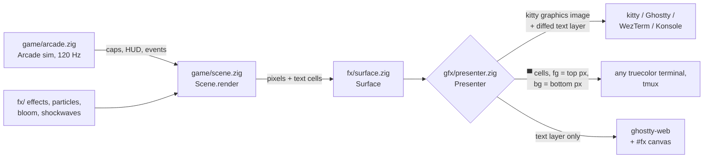

# Arcade

`snipetype arcade` is a falling-keycap typing game set in a developer's
workday. A shift starts at 09:00. Every 30 seconds the clock moves on one hour
and a new stage begins. At 19:00 Overtime starts and keeps speeding up. Type
what falls before it lands on the glowing deck above the keyboard. Each miss
costs health. The shift ends when health reaches zero, or after 60 minutes of
play.

It is a homage to [keys.maff.app](https://keys.maff.app). All art, text, rank
names and sounds here are our own, and the quotes are public domain.

```bash
snipetype arcade                     # Words game (default)
snipetype arcade --game keys         # Keys game: keycaps, vim, chords
snipetype arcade --pace 10x --speed 2
snipetype arcade --gfx cells         # force half-block rendering
```

On the web, open `?mode=arcade`, and add `&game=keys` for the Keys game.

## Controls

| Screen | Keys |
|---|---|
| Title | `tab` (or `g`) game: Words / Keys · `←`/`→` (or `h`/`l`) pace · `↑`/`↓` (or `k`/`j`) speed ×1/×2/×4/×8/×16 · `enter` clock in · `esc` quit (native) |
| Playing | type what falls · `esc` pause |
| Paused | `esc` resume · `q` back to the title |
| Results | `enter` play again · `esc`/`q` title (keys are ignored for the first 0.75 s) |
| Anywhere | `ctrl+p` settings (pauses the game) · `ctrl+c` quit (native) or back to the title (web) |

`--game`, `--pace` and `--speed` (and `?game=` on the web) only set the values
the title screen starts with. Whatever you pick there is kept when you leave
arcade and come back.

## Games

### Words (default)

Each stage deals lines of words: word lists, code identifiers, dev one-liners
and public-domain quotes. Every word falls as its own plate of letter caps, and
you type the active (lowest) word.

- **No spaces:** a word is done as soon as its last letter is typed, and a
  reflexive Space is ignored.
- **Case:** plain words are typed case-insensitively. Code identifiers (CODE
  REVIEW) are typed exactly, including `_ . -` and capitals, and they fall
  slower.
- **Punctuation:** quotes and one-liners show it, but you type only the letters.
- **Bonus caps:** from STAND-UP on, a line may bring one bonus vim cap.
- **The line under the HUD:** the active word is underlined, finished words
  light up and missed words are struck out. A finished quote holds briefly with
  its attribution.

| # | Clock | Stage | Content | Words per line |
|---|---|---|---|---|
| 0 | 09:00 | WARM-UP | short words, 3–5 letters | 1–2 |
| 1 | 10:00 | INBOX | everyday words | 1–3 |
| 2 | 11:00 | STAND-UP | longer lines, bonus vim keys | 2–4 |
| 3 | 12:00 | LUNCH RUSH | long words land harder | 2–5 |
| 4 | 13:00 | CODE REVIEW | identifiers, exactly as written | 2–5 |
| 5 | 14:00 | DEEP WORK | short quotes | 3–7 |
| 6 | 15:00 | PAIRING | one-liners from the next desk | 4–9 |
| 7 | 16:00 | DEADLINE | everything, faster | 4–11 |
| 8 | 17:00 | LAST PUSH | longer quotes | 5–14 |
| 9 | 18:00 | WRAP-UP | the long ones | 8–18 |
| 10+ | 19:00+ | OVERTIME | anything, faster | 5–18 |

The HUD shows WPM (characters / 5 per minute over a sliding 10-second window).
- Longer words fall a little slower.
- The Words day ramps 10% further than the Keys day.
- Words of 8 letters or more get a tier-2 effect.

### Keys

Single keycaps, vim motions, operator sequences, Ctrl chords and ex commands
fall. Each new stage adds a family of keys, and that family gets at least 45%
of new spawns. Earlier families stay in the mix.

| # | Clock | Stage | Adds |
|---|---|---|---|
| 0 | 09:00 | HOME ROW | `a s d f j k l ;` |
| 1 | 10:00 | EVERY LETTER | the rest of a–z |
| 2 | 11:00 | NUMBERS | digits and `- = [ ] ' , . /` |
| 3 | 12:00 | LUNCH RUSH | Space, Enter, Tab, Backspace, arrows |
| 4 | 13:00 | MOTIONS | vim keys with captions: `h` left, `w` next word, `$` line end, `G` bottom, `u` undo, `%` match pair … |
| 5 | 14:00 | OPERATORS | sequences: `gg`, `dd`, `yy`, `ciw`, `dw`, `>>`, `zz`, `ZZ`, `di(`, `gUiw` |
| 6 | 15:00 | CTRL | `Ctrl+S` save, `Ctrl+Z` undo, `Ctrl+R` redo, `Ctrl+F` find, `Ctrl+D`/`Ctrl+U`, … |
| 7 | 16:00 | EX COMMANDS | `:w`, `:q!`, `:wq`, `:noh`, `/todo`, `:%s`, `:sp`, each finished with Enter |
| 8 | 17:00 | THREE-KEY CHORDS | `Ctrl+Shift+Z`, `Ctrl+Shift+F`, `Alt+Shift+↓`, `Ctrl+Alt+↓`, … |
| 9 | 18:00 | DEEP WORK | a public-domain quote, one word at a time (letters only, no spaces) |
| 10+ | 19:00+ | OVERTIME | everything, speeding up continuously |

Three-key chords need the kitty keyboard protocol, which reports modifier
combinations that legacy terminals can't tell apart. Without it, stage 8 is
**MACROS**, which uses longer vim sequences. The web host always reports chords.
Ctrl+W/T/N/Q/C/P never appear, because browsers or the app reserve them.

Matching rules:
- A key hits a falling cap when its code and Ctrl/Alt/Super match. Shift must
  match too. For digits and symbols, the produced character is compared instead,
  so `$` needs Shift+4 to type `$`.
- In a sequence, the key must be the cap's next step. When several caps match,
  the one with the most progress wins, then the lowest one.
- A key that advances nothing is **wrong**. Modifier presses and key releases
  are never wrong.

The HUD shows keys per minute over a sliding 10-second window, times 6.

## Pace

Fall time and spawn gap ease from their start values to their end values along
a harmonic curve, `1/(1/a + (1/b − 1/a)·s)`:
- During the day, `s = day · level / 9`.
- In Overtime, `s` eases toward 1 and then keeps creeping past it, so Overtime
  never levels off.

Both times are divided by the speed multiplier.

| Pace | Fall (s) | Spawn gap (s) | Miss damage | `day` |
|---|---|---|---|---|
| JUNIOR | 7 → 2.8 | 1.5 → 0.36 | 5 | 0.71 |
| SENIOR (default) | 5.6 → 2 | 1.1 → 0.25 | 8 | 0.75 |
| STAFF | 4.4 → 1.6 | 0.85 → 0.21 | 10 | 0.645 |
| 10X | 3.4 → 1.2 | 0.6 → 0.17 | 12 | 0.45 |

Spawn placement:
- Each gap is jittered by ×0.75–1.25. Multi-key items get extra room: ×(1 + 0.4·(len − 1)).
- An item already on screen is never spawned again.
- Caps are placed to avoid overlapping live caps (16 tries, then the most free spot).

## Scoring

```
points = round(base × rarity × quick × combo_mult) × speed
```

| Target | Base |
|---|---|
| letter | 10 |
| digit / symbol | 12 |
| named key, arrow, modifier | 15 |
| Ctrl chord | 40 |
| sequence | 30 + 10·len |
| ex command | 60 |
| three-key chord | 90 |
| word | 15·letters |

- **Rarity:** rare ×2 (4% of spawns, blue jelly skin), epic ×3 (1.5%, galaxy
  purple), legendary ×5 (0.5%, gold).
- **Quick:** ×1.5 when the cap is hit in the top 35% of its fall.
- **Combo multiplier:** `min(8, 1 + combo/10)`.
- **Health:** 100 at the start.
  - A wrong key costs 2 and a miss costs the pace's miss damage. Both reset the combo.
  - A hit heals: +1 for a key or word, +3 for a chord or sequence, +5 for rare or better.
- **Milestones:** at combo 10, 20, 35, 50, 75, 100, 150 and 200 a callout
  appears, from "the linter is impressed" to "promoted to principal (unpaid)".

## Effects

Every hit picks an effect from its tier, never the same one twice in a row:

| Tier | When | Effects |
|---|---|---|
| 1 | letters, digits, short words | shatter, confetti, voxel, pop, dust |
| 2 | named keys, chords, sequences, rare caps, long words | glitch, lightning, frost, melt, fireworks |
| 3 | every 25th combo, three-key chords, epic/legendary | supernova, black hole, derez |

Intensity is `min(1, 0.2 + 0.45·min(1, combo/80) + 0.12·(keys − 1, max 3) + rarity bonus + 0.05·quick)`.
It scales particle counts, glow, shockwave strength and screen shake. A miss
cracks the cap red and sinks it, and both wrong keys and misses flash the backdrop
keyboard red.

## Results and ranks

The results card shows the following:
- "SHIFT OVER AT HH:MM" and the final score
- best combo, peak KPM, accuracy, keystrokes, average KPM and peak WPM
- your rank as a glowing keycap
- an "audible from …" line based on your average speed

Accuracy is `hits / (hits + wrong + misses)`. The hour score is
`level + 3·log2(speed)`.

| Rank (Keys) | Rank (Words) | Peak KPM (Keys) | Peak WPM (Words) | Accuracy | Hour score |
|---|---|---|---|---|---|
| hunt & peck | hunt & peck | – | – | – | – |
| home row hero | home row hero | ≥ 100 | ≥ 30 | ≥ 80% | ≥ 0 |
| vim adept | prose engine | ≥ 160 | ≥ 50 | ≥ 86% | ≥ 3 |
| macro machine | living autocomplete | ≥ 240 | ≥ 70 | ≥ 92% | ≥ 5 |
| :wq wizard | keyboard poet | ≥ 320 | ≥ 90 | ≥ 96% | ≥ 7 |

## Rendering



- **Sim** (`src/game/arcade.zig`): a deterministic fixed-step simulation (120 Hz).
  - All randomness comes from seeded RNGs, and it allocates only in `init`.
  - Its view (`phase`, `stats`, `hud`, `caps()`) and `events()` (hit, wrong,
    miss, level_up, milestone, …) drive the scene and the sounds.
- **Scene** (`src/game/scene.zig`): draws a frame into a `Surface`.
  - The surface is a pixel buffer (RGBA) plus a terminal text layer, so legends
    and HUD labels use the terminal's crisp font.
  - It draws the night backdrop, a perspective RGB keyboard with ripples on key
    presses, keycaps, the deck and health LED strip, the HUD with its flip clock,
    popups, banners, and the title/pause/results screens.
- **fx** (`src/fx/`): the pixel effects engine, using fixed pools and no per-frame
  allocation.
  - Particles, the 13 hit effects and pixel-font text.
  - Post-processing: shockwave displacement, black-hole lensing, glitch slices,
    bloom, vignette, screen shake and flash.
- **Presenters** (`src/gfx/`) turn the surface into terminal bytes. Every frame
  is one synchronized update (`CSI ?2026h … l`), and the text layer is diffed
  against the previous frame.
  - **kitty**: the pixel layer is sent as one kitty-graphics image per frame,
    placed under the text, at about half the terminal's pixel resolution (at
    most 960 px wide).
    - Media is the fastest that works: shared memory, then a temp file, then
      direct (zlib, chunked base64).
    - Used when the startup probe finds kitty graphics and we're not in tmux.
    - Known to work in Ghostty, kitty, WezTerm and Konsole.
  - **halfblock**: each cell is `▀` with fg = top pixel and bg = bottom pixel,
    which is two pixels per cell.
    - Used in tmux, with `--gfx cells` / `SNIPETYPE_GFX=cells`, and when the
      terminal has no kitty graphics.
    - Needs a **truecolor** terminal. No 256-color fallback exists, so terminals
      without 24-bit color (e.g. older macOS Terminal.app) show wrong colors.
  - **external** (web): emits the text layer only, with default-bg cells.
    The browser blits the pixels to a canvas *under* the transparent
    ghostty-web terminal (see [web.md](web.md)).
- **Capabilities** (`src/platform/caps.zig`): probed once at startup with one
  write, and finished by the DA1 reply (at most 300 ms).
  - It asks for kitty graphics support and media, kitty keyboard, cell pixel
    size, XTVERSION and synchronized output.
  - `--gfx` or `SNIPETYPE_GFX=kitty|cells` overrides the result.
- **Input**: arcade turns on kitty keyboard flags 27 (press/release events, all
  keys as escapes, with associated text), so held modifiers and three-key chords
  arrive intact. The other modes use flag 1.

The screen is never cleared with `2J` in arcade mode, because that would delete
the kitty image placement. The presenter repaints instead. On exit the image is
deleted, the keyboard flags are popped and the terminal is restored.

Preview frames headlessly (title, levels, every effect, results) as PPM files:

```bash
zig build arcade-preview -- /tmp/arcade-frames
```

## Sound (web)

Sounds come from the sim's events: key clicks panned by keyboard position,
wrong/miss thunks, a tick, crackle or boom per effect tier, level-up bells,
milestone sparkles, a phrase-done arpeggio and game over. `web/audio.js` synthesizes
them with WebAudio, with no samples. The title screen's attract demo is silent.
Toggle sound with the footer button or `?sound=0`. The native build has no audio.
