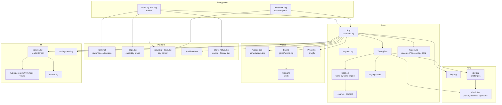
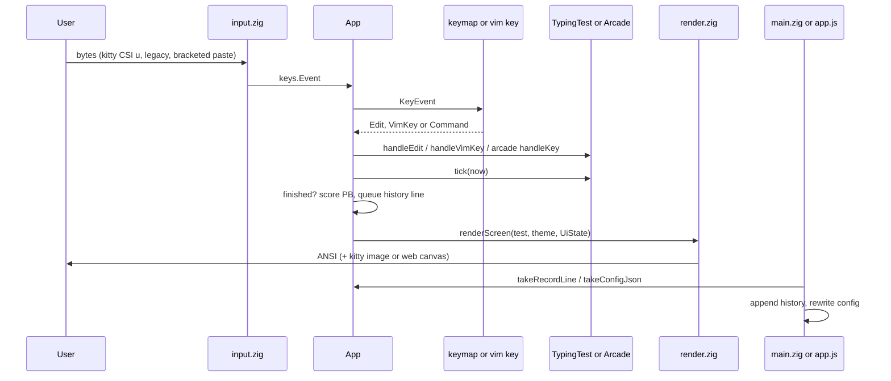
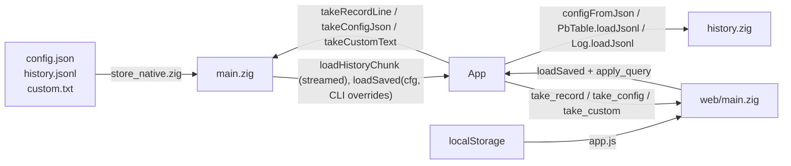
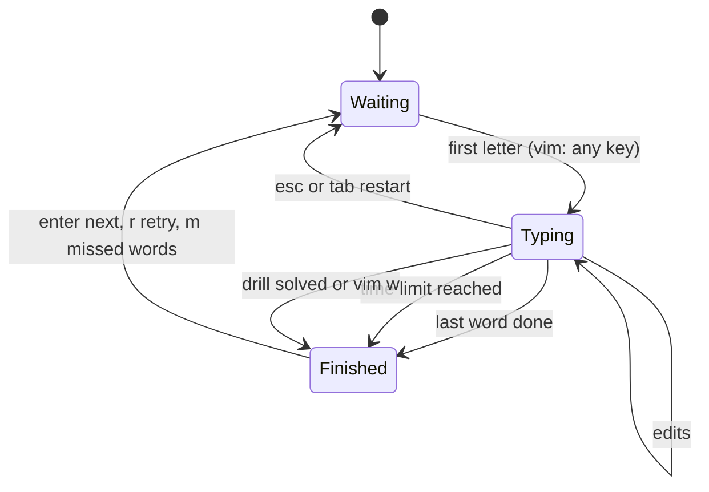
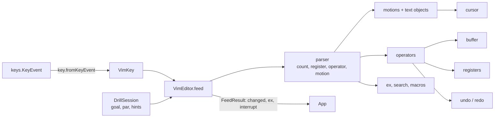
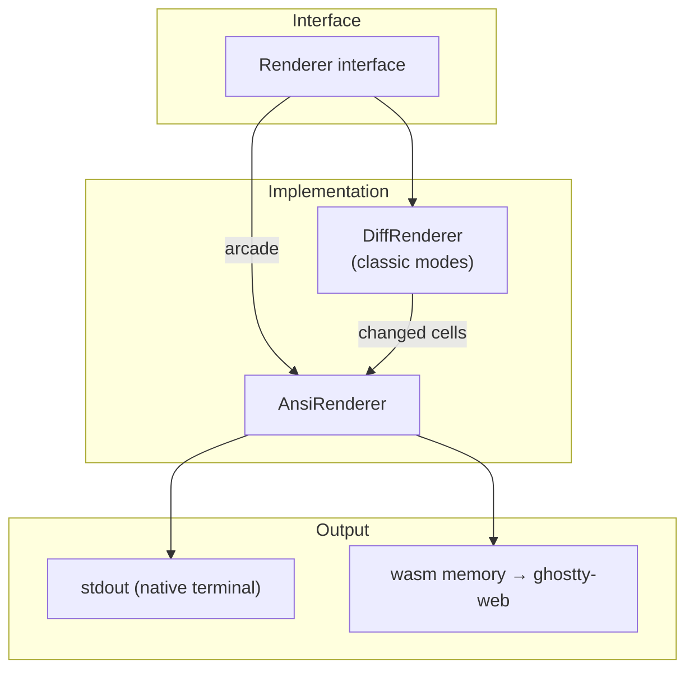
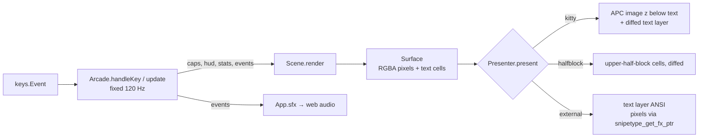
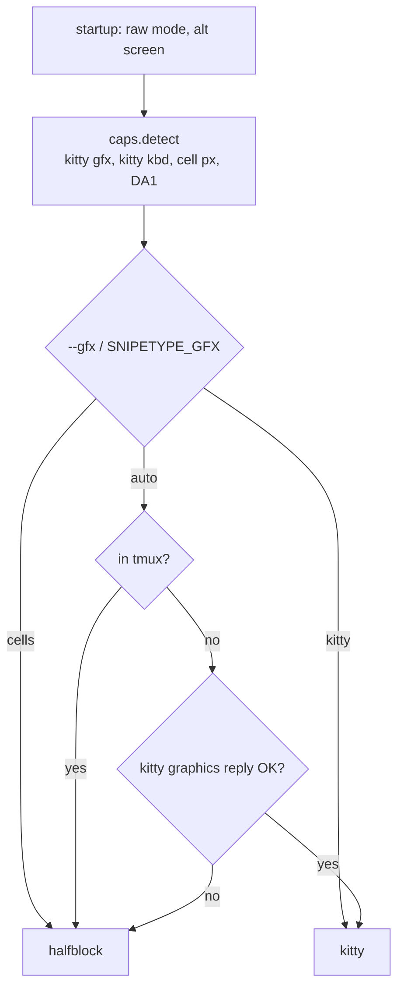
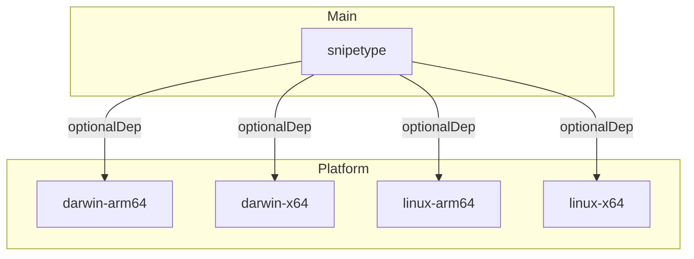

# Architecture

snipetype is a cross-platform typing test and arcade game written in Zig. It
runs natively in terminals and in browsers via WebAssembly. Both builds share
the same core and emit the same ANSI output. The browser feeds it to a
ghostty-web terminal emulator (see [web.md](web.md)).

## High-Level Overview



## Directory Structure

```
src/
├── main.zig              # Native entry: probe, saved state, main loop, cursor, restore
├── cli.zig               # Argument parsing (--mode, --tier, --theme, --drill, --no-save, --game, …)
├── root.zig              # Library exports + test entry
├── arcade_preview.zig    # `zig build arcade-preview`: headless frames → PPM
├── *_tests.zig           # Per-area test entries (core, vim, ui, platform, web, fx, gfx, game)
│
├── core/
│   ├── app.zig           # App: key routing, results keys, toasts, PBs, persistence API, render, arcade lifecycle
│   ├── keymap.zig        # KeyEvent → typing Edit or app Command (simple modes, results)
│   ├── typing_test.zig   # TypingTest: words/sentences/code session, vim type, vim drills
│   ├── session.zig       # Word-by-word engine (extra/missed letters, caret in the active word)
│   ├── keylog.zig        # Keystroke log (timing, corrections)
│   ├── stats.zig         # Live numbers and the Result (wpm, raw, acc, consistency, series, words)
│   ├── history.zig       # History records, personal bests, config JSON (pure, wasm-safe)
│   ├── source.zig        # Endless word/sentence/snippet source (tiers, punctuation, numbers)
│   ├── content.zig       # Word lists, sentences, code banks
│   ├── snippets.zig      # Multi-line code snippets
│   ├── wordlists/        # easy 200 and common 1k lists, blocklist
│   ├── types.zig         # Config, ConfigOverrides, Mode, Lang, WordTier, VimKind, Pace, Game, Gfx
│   ├── metrics.zig       # WPM helpers
│   └── rng.zig           # Random number generator
│
├── game/                 # Arcade (pure, wasm-safe)
│   ├── arcade.zig        # Deterministic 120 Hz sim: caps, scoring, events
│   ├── model.zig         # Shared data: Cap, Step, Event, Stats, Hud, Game
│   ├── levels.zig        # Stages and item pools (Keys + Words games)
│   ├── scoring.zig       # Pace curves, points, effect tiers, ranks
│   ├── layout.zig        # Cap sizes and placement in cells
│   ├── words.zig         # Words game vocabulary, identifiers, one-liners
│   ├── quotes.zig        # Public-domain quotes
│   └── scene.zig         # Draws a frame into a Surface
│
├── fx/                   # Pixel effects engine (pure, wasm-safe)
│   ├── surface.zig       # Surface: RGBA pixels + text-cell layer
│   ├── canvas.zig        # Shapes, gradients, keycaps
│   ├── particles.zig     # Fixed-capacity particle pool
│   ├── effects.zig       # The 13 hit effects, shockwaves, shake, flash
│   ├── post.zig          # Bloom, vignette, lensing, glitch
│   ├── font.zig, popup.zig, color.zig, rng.zig
│   └── fx.zig            # One-import namespace for scenes
│
├── gfx/                  # Surface → terminal bytes
│   ├── presenter.zig     # Presenter: kitty | halfblock | external
│   ├── kitty.zig         # Kitty graphics protocol encoder
│   ├── media.zig         # shm / temp file / direct transfer
│   ├── halfblock.zig     # ▀ cells, diffed
│   ├── textlayer.zig     # Diffed text layer over pixels
│   └── ansi.zig, bench.zig
│
├── vim/                  # Vim engine (see vim.md)
│   ├── key.zig           # VimKey, KeyEvent → VimKey, key notation
│   ├── editor.zig        # VimEditor facade: feed(key) → FeedResult
│   ├── drill.zig         # Lessons, challenges, DrillSession, stars
│   ├── challenges/       # Drill data per lesson
│   └── …                 # buffer, classify, motion, textobj, operator, register, undo, search, ex
│
├── platform/
│   ├── terminal.zig      # Raw mode, alt screen, kitty keyboard flags,
│   │                     #   cursor shape, restore on exit/signal/panic
│   ├── caps.zig          # Startup capability probe (kitty gfx/kbd, cell px)
│   ├── input.zig         # Byte parser → keys.Event (CSI u, xterm, replies)
│   ├── keys.zig          # KeyEvent, Mods, kitty key codes
│   ├── renderer.zig      # Abstract renderer interface
│   ├── ansi_renderer.zig # ANSI escape codes (native and wasm)
│   ├── store_native.zig  # Config/history paths (XDG, SNIPETYPE_HOME), atomic writes
│   ├── stdout.zig        # Unbuffered stdout writes
│   └── time.zig          # Platform time abstraction
│
├── ui/
│   ├── render.zig        # renderScreen / getCursorPos: dispatch to the views
│   ├── draw.zig          # Shared drawing helpers
│   ├── ui_state.zig      # UiState: PB outcome, bests, toast, web (filled by the App)
│   ├── typing_view.zig   # Words/sentences/code: per-word colors, code lines
│   ├── results.zig       # Results card, PB banner, graph
│   ├── vim_view.zig      # Vim type: scrolling buffer, status line
│   ├── drill_view.zig    # Vim drills: buffer and goal panes, solved card
│   ├── config_bar.zig    # Idle "words · common · 25" bar
│   ├── theme.zig         # Color themes
│   ├── settings.zig      # Settings overlay (theme, mode, test options)
│   ├── ansi.zig          # Glyphs, box drawing, braille
│   └── color.zig         # RGB color type
│
└── web/
    └── main.zig          # WASM exports for JavaScript
```

## Data Flow



Key routing (contract 6 of the level-up plan):

- **Arcade:** every event goes to the sim, including releases. The App only
  handles Ctrl+C, Ctrl+P and Esc on the title screen.
- **Words, sentences, code:** `keymap.typingAction` turns a `KeyEvent` into a
  `session.Edit` (a letter, backspace, delete word for Ctrl+W, Ctrl+Backspace,
  Alt+Backspace or Ctrl+H, delete line for Ctrl+U, caret keys inside the active
  word) or a command: Esc/Tab restart, Ctrl+C quit (web: restart), Ctrl+P
  settings.
- **Vim:** `vim/key.zig` `fromKeyEvent` gives zero to two `VimKey`s (Alt+x is
  Esc then x, so a fast `Esc o` from a legacy terminal still works). The App
  keeps Ctrl+P (settings), F1 (drill hint) and Tab in NORMAL with nothing
  pending (restart / next drill). Ctrl+C is fed as Esc; in NORMAL a second
  Ctrl+C within 1.5 s quits (web: restarts). `FeedResult.ex` carries `:w`
  (submit), `:q` (next), `:q!` (quit), `:e!` (retry) and `:hint`.
- **Results:** `keymap.resultsAction`: Enter/Space next, `r` retry, `m`
  missed words, Tab/Esc new text, `q` quit.
- **Bracketed paste:** keys between `CSI 200~` and `CSI 201~` are dropped
  outside the arcade and the run is marked as pasted (never recorded).
- **Settings overlay:** keys go through `KeyEvent.toLegacy()`; native Ctrl+C
  quits even there.

Redraws: every key redraws at once; while typing with nothing changed the
screen is redrawn at most every 100 ms (timer and live stats). Arcade frames
keep their own timing.

The App also decides the hardware cursor (`App.cursorStyle()`):
- hidden in arcade, over the settings overlay, on the results screen and on
  the vim command line (which draws its own caret);
- a block in vim normal/visual mode;
- a bar while typing and in vim insert/replace.

The native loop shows/hides the cursor and sets its shape with DECSCUSR, and
the terminal restore resets it. The web host applies the same style through
ghostty-web's options.

## Persistence



The App never touches files. `history.zig` owns every format (config JSON,
history records, personal-best keys) and is pure, so the same code runs on
wasm. Precedence: defaults, then the saved config, then CLI flags or URL
parameters. Only valid runs (at least 1 s, no paste) and solved drills are
recorded. Natively the config is rewritten through a temp file and a rename,
history is append-only, and I/O errors show one toast.

- **History aggregate.** Besides the personal-best table (`PbTable`), the
  App keeps a `history.Log`: the newest 500 runs, totals over every run and
  the summed per-key stats (`"pk"` in each record). The history screen, the
  weak-key weights (`w` on results, `--weak`) and `snipetype stats` read it.
  `checkFinish` adds each new record line to it.
- **Big histories.** `main.zig` streams `history.jsonl` in 1 MiB chunks of
  whole lines into `App.loadHistoryChunk` (no size cap). Past 16 MB the file
  is compacted under the append lock: `App.pbLines()` (one `"pb":true` line
  per best) plus the newest 5,000 runs. The web host trims to 1,000 runs and
  writes the PB lines first.
- **Symlinks.** Saving `config.json` or `custom.txt` resolves a symlink
  (up to 8 hops, relative to the link's directory) and replaces the target,
  so dotfile links survive.
- **Custom text.** `--text`, `--file` and piped stdin arrive as
  `ConfigOverrides.custom_text` (stdin is read fully, then `/dev/tty` is
  `dup2`ed onto fd 0 for the terminal); a bracketed paste on the custom idle
  screen and the web dialog call `App.setCustomText`. Hosts persist what
  `takeCustomText` returns.

## Typing Test State Machine



## Vim Mode Architecture

Keys are parsed into a command first and executed second, so counts,
registers and operators compose (`2"ad3w`). The details, and what is and isn't
supported, are in [vim.md](vim.md).



## Renderer Abstraction

The `Renderer` interface lets the same UI code produce ANSI for both builds.
Natively, `AnsiRenderer` writes to stdout. On wasm it keeps the bytes in memory,
and the host passes them to ghostty-web. (`cell_renderer.zig` is the old cell-grid
web renderer and is no longer used by the host.)

Classic modes draw through `DiffRenderer` (`platform/diff_renderer.zig`): it
implements the same interface into a back grid of cells (glyph, colors,
bold, underline, terminal-default flags), and `flush` writes only the cells
that differ from what the terminal already shows, as runs per row with SGR
changes only where the pen changes, ending with a cursor move to the last
`moveTo`. `clear()` (resets, resizes, theme and overlay changes) and
`invalidate()` (resize, leaving arcade) force a full repaint; raw escapes
written by the app pass through. Arcade frames bypass it and keep the plain
`AnsiRenderer` path byte for byte.



### Overlays and the render tail

The App draws one of: the test screen, the settings overlay (Ctrl+P), or
the **history screen** (`App.overlay`, F2 or `h`; tabs recent / bests /
keys, scroll state in the App, keys from `keymap.historyAction`). Overlays
open and close with a full clear. Redraws are driven by `dirty` plus three
timers: typing (100 ms, 50 ms while a pace caret moves), toasts, and the
**animation tail**: after a finish, `render.animating(...)` stays true while
the results count up, the graph draws in and a PB sparkles (≤ 1.5 s), and
`shouldRender`/`getPollWaitMs` then redraw every `ANIM_FRAME_MS` (33 ms).
The arcade never uses the tail.

### Renderer Methods

| Method | Description |
|--------|-------------|
| `moveTo(x, y)` | Position cursor |
| `write(str)` | Write text |
| `setFg(color)` | Set foreground color |
| `setBg(color)` | Set background color |
| `setBold(on)` / `setUnderline(on)` | Text attributes (`resetStyle()` clears them) |
| `clear()` | Clear screen |
| `flush()` | Flush buffer to output |

## Arcade Pipeline

Arcade state is created lazily when the mode switches to arcade and destroyed
when it switches away. It consists of the sim, the scene, a `Surface` and a
`Presenter`. Each frame, at about 60 fps, the scene draws pixels and text cells
into the surface. The presenter then turns the surface into bytes for the
backend chosen at startup. Game rules and the look are covered in
[arcade.md](arcade.md).



Native startup chooses the backend:



## Theme System

Themes define colors for UI elements:

```zig
pub const Theme = struct {
    fg: Color,          // default foreground
    bg: Color,          // default background
    accent: Color,      // highlights, header
    success: Color,     // correct characters
    danger: Color,      // errors
    warning: Color,     // vim normal mode
    // ...
};
```

Built-in themes: `system`, `one_dark`, `one_light`, `dracula`, `nord`,
`gruvbox_dark`, `solarized_dark`, `serika_dark`, `catppuccin_mocha`,
`tokyo_night`, `rose_pine`, `everforest`, `gruvbox_light` (ids are stable;
`theme.slug` / `fromSlug` give the saved names such as `one-dark`).

## npm Distribution



The main `snipetype` package contains a JS wrapper that:
1. Detects the platform
2. Resolves the correct binary from optionalDependencies
3. Executes it with `execFileSync`

## Build Targets

| Target | Output | Usage |
|--------|--------|-------|
| `zig build` | `zig-out/bin/snipetype` | Native CLI |
| `zig build web` | `zig-out/bin/snipetype_web.wasm` | Browser |
| `zig build web-dist` | `web/dist/snipetype_web.wasm` | ReleaseSmall wasm served by the web host |
| `zig build arcade-preview -- <dir>` | PPM frames in `<dir>` | Headless arcade previews |
| `node npm/build.mjs` | Platform binaries in `npm/*/bin/` | npm release |
