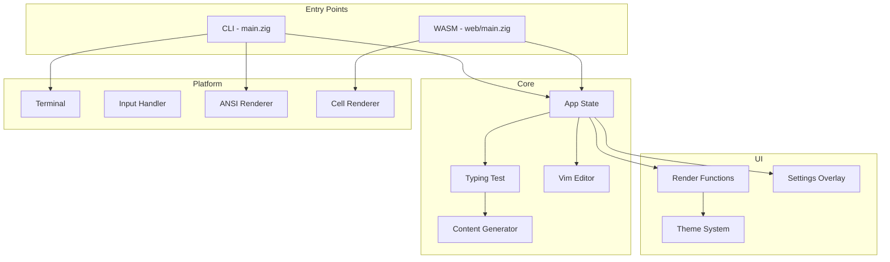
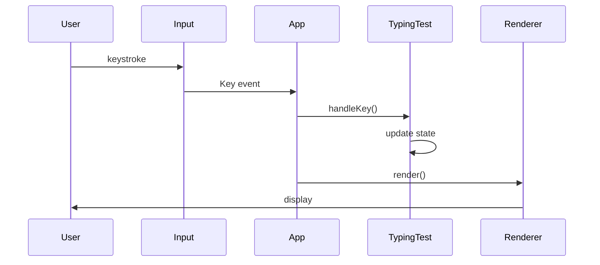
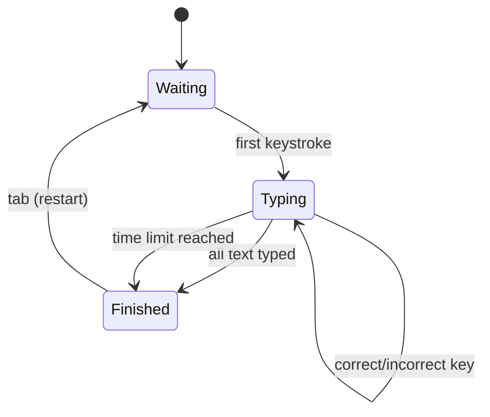
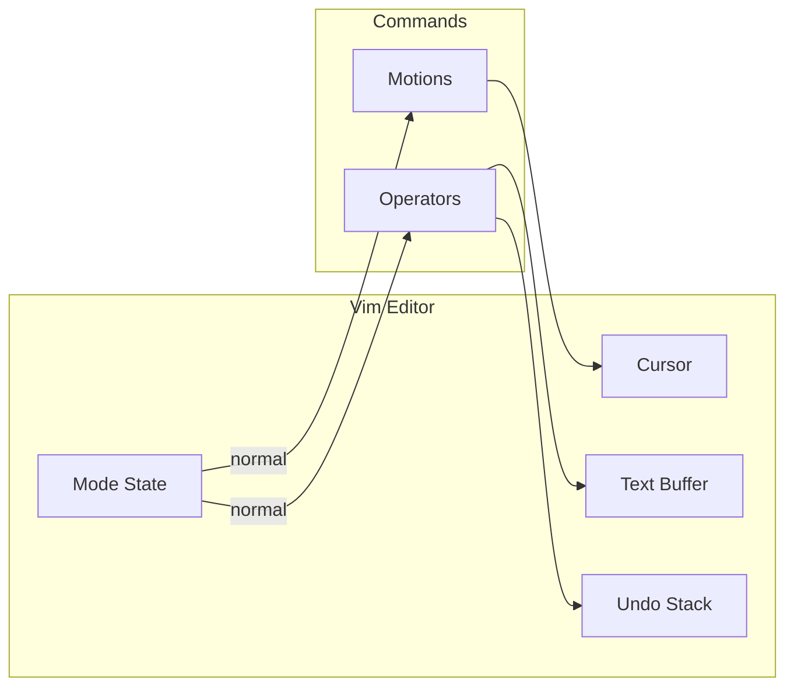
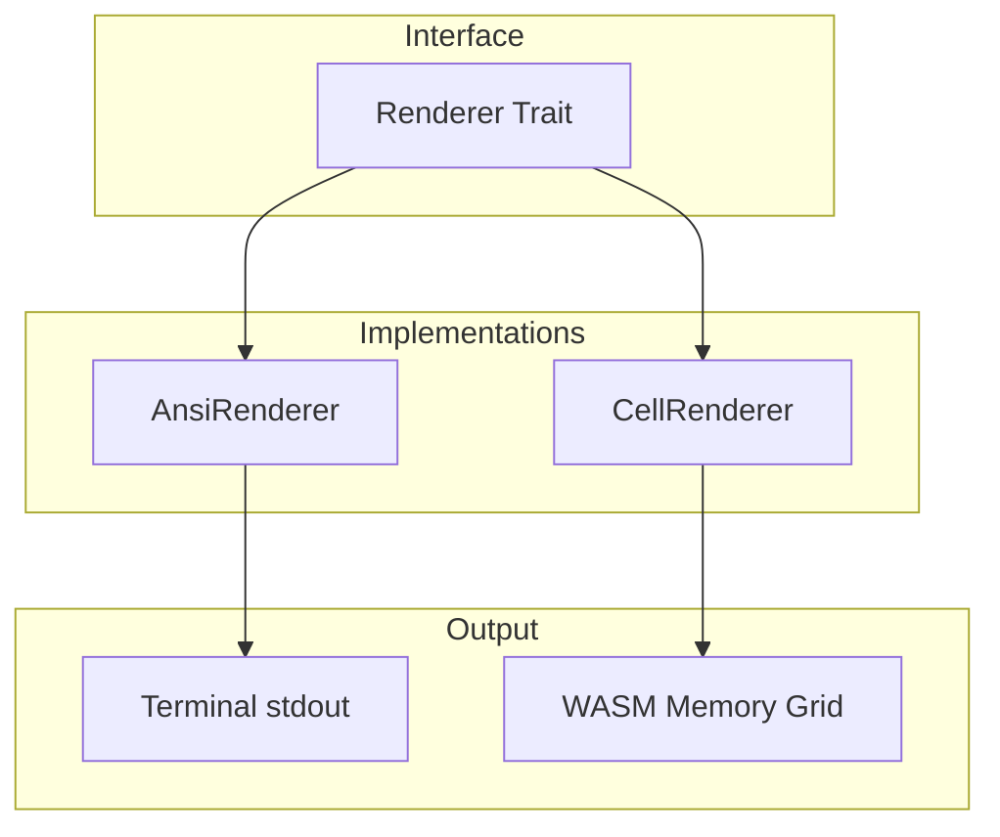

# Architecture

snipetype is a cross-platform typing test written in Zig. It runs natively in terminals and in browsers via WebAssembly.

## High-Level Overview



## Directory Structure

```
src/
├── main.zig              # Native CLI entry point
├── cli.zig               # Argument parsing
├── root.zig              # Library exports
│
├── core/
│   ├── app.zig           # Application state & logic
│   ├── typing_test.zig   # Typing test state machine
│   ├── content.zig       # Text generation (words, sentences, code)
│   ├── types.zig         # Shared types (Config, Mode, Lang)
│   ├── metrics.zig       # WPM, accuracy calculations
│   └── rng.zig           # Random number generator
│
├── vim/
│   ├── editor.zig        # Vim editor state & commands
│   ├── buffer.zig        # Text buffer (lines)
│   ├── cursor.zig        # Cursor position
│   ├── mode.zig          # normal/insert/visual modes
│   ├── motions.zig       # h,j,k,l,w,b,e,$,^,gg,G
│   ├── operators.zig     # d,c,y,x,p,J,r
│   └── undo.zig          # Undo/redo stack
│
├── platform/
│   ├── terminal.zig      # POSIX terminal (raw mode)
│   ├── input.zig         # Key parsing (escape sequences)
│   ├── renderer.zig      # Abstract renderer interface
│   ├── ansi_renderer.zig # ANSI escape codes (native)
│   ├── cell_renderer.zig # Cell grid (WASM)
│   └── time.zig          # Platform time abstraction
│
├── ui/
│   ├── render.zig        # UI rendering (simple & vim modes)
│   ├── theme.zig         # Color themes
│   ├── settings.zig      # Settings overlay
│   └── color.zig         # RGB color type
│
└── web/
    └── main.zig          # WASM exports for JavaScript
```

## Data Flow



## Typing Test State Machine



## Vim Mode Architecture



## Renderer Abstraction

The `Renderer` interface allows the same UI code to work on both native terminals and web browsers.



### Renderer Methods

| Method | Description |
|--------|-------------|
| `moveTo(x, y)` | Position cursor |
| `write(str)` | Write text |
| `setFg(color)` | Set foreground color |
| `setBg(color)` | Set background color |
| `clear()` | Clear screen |
| `flush()` | Flush buffer to output |

## Theme System

Themes define colors for UI elements:

```zig
pub const Theme = struct {
    fg: Color,          // default foreground
    bg: Color,          // default background
    accent: Color,      // highlights, header
    success: Color,     // correct characters
    danger: Color,      // errors
    warning: Color,     // vim normal mode
    // ...
};
```

Built-in themes: `system`, `one_dark`, `one_light`, `dracula`, `nord`, `gruvbox_dark`, `solarized_dark`

## npm Distribution

```mermaid
graph TB
    subgraph "Main Package"
        snipetype[snipetype]
    end

    subgraph "Platform Packages"
        darwin-arm64[@snipetype/darwin-arm64]
        darwin-x64[@snipetype/darwin-x64]
        linux-arm64[@snipetype/linux-arm64]
        linux-x64[@snipetype/linux-x64]
    end

    snipetype -->|optionalDependencies| darwin-arm64
    snipetype -->|optionalDependencies| darwin-x64
    snipetype -->|optionalDependencies| linux-arm64
    snipetype -->|optionalDependencies| linux-x64
```

The main `snipetype` package contains a JS wrapper that:
1. Detects the platform
2. Resolves the correct binary from optionalDependencies
3. Executes it with `execFileSync`

## Build Targets

| Target | Output | Usage |
|--------|--------|-------|
| `zig build` | `zig-out/bin/snipetype` | Native CLI |
| `zig build web` | `zig-out/bin/snipetype_web.wasm` | Browser |
| `node npm/build.mjs` | Platform binaries in `npm/*/bin/` | npm release |
