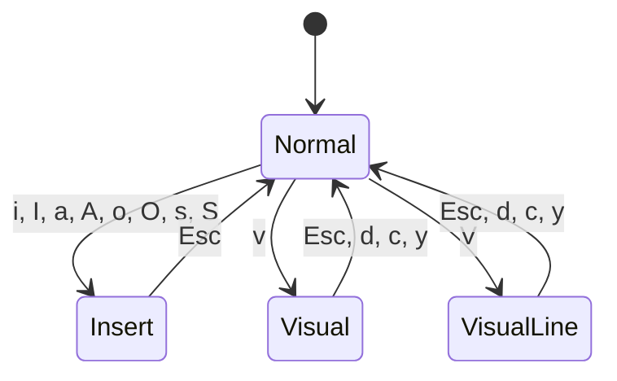

# Vim Mode

snipetype includes a vim-style editor for multi-line typing practice.

## Modes



| Mode | Description |
|------|-------------|
| **Normal** | Navigate and execute commands |
| **Insert** | Type text |
| **Visual** | Select characters |
| **Visual Line** | Select entire lines |

## Motions

### Character Movement

| Key | Action |
|-----|--------|
| `h` | Left |
| `l` | Right |
| `j` | Down |
| `k` | Up |

### Word Movement

| Key | Action |
|-----|--------|
| `w` | Next word start |
| `b` | Previous word start |
| `e` | Word end |

### Line Movement

| Key | Action |
|-----|--------|
| `0` | Line start |
| `^` | First non-space |
| `$` | Line end |

### Document Movement

| Key | Action |
|-----|--------|
| `gg` | First line |
| `G` | Last line |

## Entering Insert Mode

| Key | Action |
|-----|--------|
| `i` | Insert before cursor |
| `I` | Insert at line start |
| `a` | Insert after cursor |
| `A` | Insert at line end |
| `o` | New line below |
| `O` | New line above |
| `s` | Delete char, enter insert |
| `S` | Delete line, enter insert |

## Operators

Operators act on motions or selections.

### Delete

| Key | Action |
|-----|--------|
| `x` | Delete character |
| `X` | Delete character before |
| `d{motion}` | Delete motion |
| `dd` | Delete line |
| `D` | Delete to end of line |

### Change

| Key | Action |
|-----|--------|
| `c{motion}` | Change motion |
| `cc` | Change line |
| `C` | Change to end of line |

### Yank (Copy)

| Key | Action |
|-----|--------|
| `y{motion}` | Yank motion |
| `yy` | Yank line |

### Put (Paste)

| Key | Action |
|-----|--------|
| `p` | Paste after |
| `P` | Paste before |

### Other

| Key | Action |
|-----|--------|
| `J` | Join lines |
| `r{char}` | Replace character |

## Visual Mode

1. Press `v` (character) or `V` (line)
2. Move cursor to extend selection
3. Press operator: `d` (delete), `c` (change), `y` (yank)

## Examples

```
dw      # Delete word
d$      # Delete to end of line
dd      # Delete entire line
2dd     # Delete 2 lines
ciw     # Change inner word
yy      # Yank line
p       # Paste
gg      # Go to top
G       # Go to bottom
```

## Implementation

The vim editor is implemented in `src/vim/`:

```
vim/
├── editor.zig    # Main editor, command dispatch
├── buffer.zig    # Line-based text storage
├── cursor.zig    # Position tracking
├── mode.zig      # Mode enum
├── motions.zig   # Movement commands
├── operators.zig # Delete, change, yank
├── register.zig  # Yank register
└── undo.zig      # Undo/redo stack
```

### Buffer Structure

```zig
pub const Buffer = struct {
    lines: std.ArrayList(std.ArrayList(u8)),
    
    pub fn getLine(self: *Buffer, row: usize) []const u8;
    pub fn insertChar(self: *Buffer, row: usize, col: usize, char: u8) void;
    pub fn deleteLine(self: *Buffer, row: usize) void;
    // ...
};
```

### Operator-Motion Pattern

```zig
// Pending operator waits for motion
pending_op: Operator = .none,

// When motion received:
fn executeOperator(self: *Editor, op: Operator, start: Pos, end: Pos) void {
    switch (op) {
        .delete => self.deleteRange(start, end),
        .change => {
            self.deleteRange(start, end);
            self.mode = .insert;
        },
        .yank => self.yankRange(start, end),
    }
}
```
