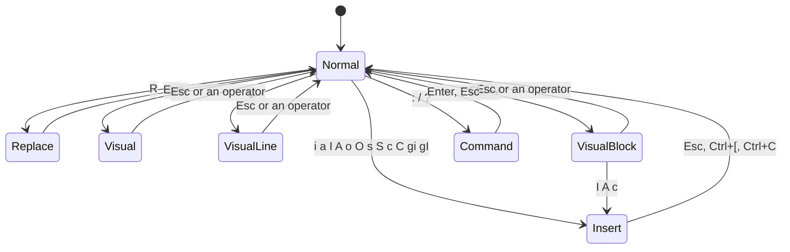

# Vim Mode

snipetype has a Vim engine for two kinds of practice:

- **Drills** (the default): short VimGolf-style challenges. You turn a start buffer into a goal buffer in as few keystrokes as you can.
- **Retype** (`--vim type`): you retype a code snippet in a real editor.

Both modes use the same engine (`src/vim/`), and it aims to behave like Vim/Neovim for everything below. The settings are fixed: `shiftwidth=4`, `expandtab`, `autoindent`, `ignorecase` + `smartcase`, `wrapscan`, `startofline`, `tabstop=8`, `textwidth=79`, `backspace=indent,eol,start` and `scrolloff=2`. Most behaviour is checked case by case against `nvim --clean` with those settings.

## Modes

| Mode | Status label |
|------|--------------|
| Normal | `NORMAL` |
| Insert | `INSERT` |
| Replace | `REPLACE` |
| Visual (characters) | `VISUAL` |
| Visual Line | `V-LINE` |
| Visual Block | `V-BLOCK` |
| Command line (`:`, `/`, `?`) | `COMMAND` |

How keys are handled:

- **Ctrl+C** acts like Esc in every mode. In Normal mode with nothing pending, it asks the app to quit.
- **Ctrl+[** is Esc.
- **Arrow keys** cancel a pending operator or count.
- **Shift or Ctrl + Left/Right** act as `b` / `w`. **Ctrl+Up/Down** (and Ctrl+Home/End) act as `gg` / `G`.
- **Home/End** act as `0` / `$`, in Insert mode as well.
- **PageUp/PageDown** act as Ctrl+B / Ctrl+F.
- **Tab** in Normal mode starts a new test (a new snippet; in drills, the next drill), as everywhere else in the app; in a Visual mode it leaves the selection like Esc. A legacy terminal sends the same byte for `Tab` and `Ctrl+I`, so there `Ctrl+I` does the same; jumping forward with `Ctrl+I` needs a terminal with the kitty keyboard protocol (kitty, WezTerm, Ghostty, foot, recent iTerm2) or the web version.
- **Alt+key** is read as Esc followed by the key, as in a terminal.

## Motions

Any motion takes a count (`3w`, `2}`) and can follow an operator (`d3w`).

| Keys | Moves to | Kind |
|------|----------|------|
| `h` `l` `Backspace` `Space` | left / right (Backspace and Space wrap lines) | exclusive |
| `j` `k` `Ctrl+N` `Ctrl+P` `gj` `gk` | down / up, keeping the display column, so a tab counts as the cells it fills; from a cursor on a tab (Normal mode) the column kept is the tab's last cell, as in Vim (sticks to the line end after `$`) | linewise |
| `w` `b` `e` `ge` | next word start, previous word start, word end, previous word end | `e` and `ge` inclusive, the others exclusive |
| `W` `B` `E` `gE` | the same for WORDs, where any run of non-blanks counts as one WORD | as above |
| `0` `^` `$` `g_` `\|` | line start, first non-blank, line end, last non-blank, screen column N | `$` and `g_` inclusive |
| `gg` `G` | first or last line; with a count, line N | linewise |
| `+` `Enter` `-` `_` | first non-blank of the next line, the previous line, or N−1 lines down | linewise |
| `f{c}` `F{c}` `t{c}` `T{c}` | the char on the line, or just before/after it with `t`/`T` | `f` and `t` inclusive |
| `;` `,` | repeat the last f/t, in the same or the opposite direction | |
| `%` | the matching `()[]{}` (searches forward on the line first); with a count, that percentage of the file | inclusive |
| `{` `}` | the previous or next blank line (paragraph) | exclusive |
| `(` `)` | the previous or next sentence start (see [Sentences](#sentences)) | exclusive |
| `H` `M` `L` | the top, middle or bottom of the view | linewise |
| `n` `N` `*` `#` | see [Search](#search) | exclusive |
| `` `{a-z} `` `'{a-z}` | a mark (set with `m{a-z}`); see [Jumps and marks](#jumps-and-marks) for `''`, `'.`, `` `^ `` | |
| `Ctrl+O` `Ctrl+I` | back / forward through the jump list (`Ctrl+I` needs the kitty keyboard protocol or the web; see Keys) | |
| `g;` `g,` | back / forward through the change list | |

Word classes follow Vim. Keyword characters are `[A-Za-z0-9_]`. Any other non-blank character is punctuation, so `foo(bar)` holds three words. An empty line counts as a word.

Two Vim rules apply to motion ranges:

- If an exclusive motion ends in column 0 of a later line, the end moves back to the end of the previous line. If the motion also started at or before the first non-blank, the range becomes linewise (`d}`).
- `cw` and `cW` on non-blank text act like `ce` and `cE`. `dw` on the last word of a line stops at the end of that line.

## Operators

`[count]["x]operator[count]motion`. The two counts multiply, so `2d3w` deletes six words. A doubled operator works on lines: `dd`, `cc`, `yy`, `>>`, `<<`, `g~~`, `guu`, `gUU`, `gqq`, `gww`, `==`.

| Keys | Action |
|------|--------|
| `d` `c` `y` | delete, change (delete, then Insert), yank |
| `>` `<` | shift lines by `shiftwidth` |
| `g~` `gu` `gU` | toggle case, lowercase, uppercase |
| `gq` `gw` | format lines to `textwidth` (79); `gw` keeps the cursor on the same text. See [Formatting](#formatting-gq-and-) |
| `=` | reindent lines (a "cindent-lite", see [Formatting](#formatting-gq-and-)) |
| `x` `X` `s` `S` | `dl`, `dh`, `cl`, `cc` |
| `D` `C` `Y` | `d$`, `c$`, `y$` (Neovim's `Y`) |
| `p` `P` | put after / before; a count repeats the text. Charwise puts leave the cursor on the last char put; linewise puts leave it on the first non-blank of the first line put. |
| `J` `gJ` | join lines. `J` strips the next line's indent and adds one space, except before `)` or after a trailing blank. A count gives the number of lines. |
| `~` | toggle the case of N chars |
| `r{c}` | replace N chars; `r<Enter>` splits the line |
| `R` | Replace mode; Backspace restores the original text |
| `Ctrl+A` `Ctrl+X` | add or subtract N from the next number on the line (decimal, negative or `0x` hex) |
| `u` `Ctrl+R` | undo and redo |
| `U` | undo all the latest changes on the last changed line. `U` is itself a change: `u` undoes it and another `U` redoes the changes. |
| `g-` `g+` | step back / forward through every text state in the order it was made, across undo branches (`:earlier N`, `:later N` take a count of steps) |
| `.` | repeat the last change; a count replaces the original count. Repeating a put from a numbered register uses the next one, so `"1p..` (or `"1pu.u.`) walks back through older deletes. |
| `cc` / `S` / `o` / `O` | keep the line's indent (autoindent) |

**Undo** records one step per Normal-mode command, per whole Insert session (an arrow key in Insert mode starts a new step, as in Vim), per dot repeat, per macro and per `:g`. A change that did nothing isn't recorded. After undo or redo the cursor goes where Vim puts it: back where the change started when that is on or next to the changed lines, otherwise to the first changed line. At either end you see "Already at oldest change" or "Already at newest change".

Undo is a tree, as in Vim. Making a change after `u` starts a new branch; `Ctrl+R` follows the branch you undid last, and `g-`/`g+` visit the states of all branches in time order. Undo and redo also put back the marks `a`–`z` as they were before the change, so a mark on a deleted line returns with the line.

`U` remembers one line: the line of the latest change that stayed within a single line, as it was before the first of those changes. Deleting lines (`dd`, `:d`) or opening and splitting lines (`o`, `O`, Enter in Insert mode, `:t`, `:m`) makes it forget. As in Vim, the remembered line number doesn't move when lines are inserted above it.

## Text objects

Text objects work after an operator and in Visual mode, with counts (`d2i(` deletes inside the second enclosing pair of parens).

| Object | Inner (`i`) | Around (`a`) |
|--------|-------------|--------------|
| `w` / `W` | the word or WORD (or the run of blanks) | plus trailing whitespace, or leading whitespace when there is none trailing |
| `"` `'` `` ` `` | the text between the quotes, on one line; searches forward on the line | plus the quotes and trailing whitespace (leading if there is none trailing) |
| `(` `)` `b` | inside the parens; pairs nest and may span lines | plus the parens |
| `[` `]` | brackets | |
| `{` `}` `B` | braces; when the braces sit on their own lines, the inner object is linewise, so `ci{` keeps them on their own lines | |
| `<` `>` | angle brackets | |
| `p` | the paragraph | plus the blank lines after it |
| `s` | the sentence (or the run of blanks between two) | plus the blanks after it, or before it when there are none after |
| `t` | inside an HTML/XML tag pair: `<a href="x">text</a>`; pairs nest and may span lines | plus the tags |

Bracket objects follow Vim's rules:

- When the cursor isn't inside a pair, `i(` and friends use the next opening bracket after the cursor, on this line or a later one (`d2i[` takes the second one).
- The opening bracket is found without regard to quotes; the closing one skips `"…"` strings, and an opening bracket inside a string only pairs with a closing bracket in the same string. So `f(a, "(", b)` with the cursor on `b` fails, as in Vim.
- In Visual mode, repeating the object (`vi(i(`, `va{a{`) grows the selection to the enclosing pair.

Tag objects follow Vim's `current_tagblock`: on a start tag the object is that tag's block, on an end tag the block it closes; a tag with no end tag (like `
` or `<li>` left open) is skipped in favour of the one around it; ` ` is not a tag pair; names match without regard to case. Repeating `it` or `at` in Visual mode selects the next enclosing block.

## Registers

| Register | Contents |
|----------|----------|
| `""` | unnamed: the last delete or yank |
| `"0` | the last yank |
| `"1`–`"9` | deletes of a line or more, shifted on each delete (also `d%`, `d/…`, `dn`, `d{`, `d}`) |
| `"-` | small deletes (less than a line) |
| `"a`–`"z` | named; `"A`–`"Z` append to them |
| `"_` | black hole: the text is discarded and no other register changes |

`x`, `X`, `s`, `S`, `D` and `C` write registers like any delete. Each register remembers whether its text is linewise, and an empty linewise yank still puts an empty line.

## Insert mode

| Keys | Action |
|------|--------|
| `Ctrl+W` | delete the word before the cursor, using the word classes. It stops once at the place where Insert started, then continues. At column 0 it joins with the previous line. |
| `Ctrl+U` | delete back to where Insert started, then to the indent, then to the line start |
| `Backspace` `Ctrl+H` | delete a char; at column 0, join with the previous line. Inside leading spaces it deletes back to the previous `shiftwidth` stop. |
| `Delete` | delete the char under the cursor; at the line end, join the next line |
| `Enter` `Ctrl+M` `Ctrl+J` | new line, copying the indent. An indent you leave unused is removed when you type Enter or Esc. |
| `Tab` `Ctrl+I` | spaces up to the next multiple of 4 |
| `Ctrl+T` `Ctrl+D` | indent or outdent the line to the next multiple of `shiftwidth` |
| `Ctrl+R {reg}` | insert a register |
| `Ctrl+O {cmd}` | run one Normal-mode command, then return to Insert |
| `Ctrl+E` `Ctrl+Y` | copy the char below or above the cursor |
| arrows, `Home`, `End`, word arrows | move (this starts a new undo step) |
| `Esc` `Ctrl+[` `Ctrl+C` | back to Normal, with the cursor moved one left |

A count repeats the typed text: `3ix<Esc>` gives `xxx`, and `2o` opens two lines. The `inserted` stat counts the printable characters you type in Insert or Replace mode.

## Visual mode

`v` selects characters and `V` selects lines. Every motion and text object works, with counts and `g` prefixes (`ge`, `gg`). `o` swaps the ends and `gv` reselects the last selection. As in Vim, the cursor can rest on the end of a line in Visual mode (after `l` on the last character, `$`, or `j`/`k` from a column past the line's end), and the selection then includes the line break. Repeating `ip`/`ap` extends the selection by the next paragraph.

| Keys | Action |
|------|--------|
| `d` `x` | delete |
| `c` `s` | change. `Vc` leaves one empty, auto-indented line. |
| `y` | yank; the cursor goes to the start |
| `X` `D` `C` `S` `R` `Y` | the linewise forms |
| `>` `<` | shift lines (a count shifts several times) |
| `~` `u` `U` | toggle case, lowercase, uppercase |
| `J` `gJ` | join the selected lines |
| `r{c}` | replace every selected char |
| `p` `P` | replace the selection with a register (`P` keeps the register) |
| `I` `A` | insert at the start or end of the selection |
| `:` | Ex command over `'<,'>` |
| `Esc` `Ctrl+C` `v` `V` | back to Normal (or switch the selection kind) |

`.` after a visual change repeats it on the same number of characters or lines from the cursor.

## Visual Block mode

`Ctrl+V` selects a rectangle (`V-BLOCK`). Its corners are the cursor and the anchor, in display columns, so tabs count as the cells they fill; a tab cut by the edge of the block is split into spaces first, as Vim does. While you select, the status line shows the size as `rows`x`columns` (`3x4`). `$` extends every row to its own line end, `o` goes to the opposite corner and `O` to the other corner on the same row.

| Keys | Action |
|------|--------|
| `d` `x` | delete the block |
| `D` `X` `Y` | `D` deletes from the block's left edge to every line end; `X` and `Y` act on the block |
| `c` `s` | change: delete the block, then type on the top row; Esc copies the text to every row |
| `C` | change from the left edge to every line end |
| `y` | yank as a block register; `p` and `P` put it back as a block, padding short lines with spaces |
| `I` `A` | insert before (`I`) or after (`A`) the block on every row. Rows too short to reach the block are skipped by `I`, and padded with spaces by `A` (or `$A` appends at each line end). The rows fill in when you press Esc (Ctrl+C too, as in Neovim). A count types the text that many times (`3I-`). |
| `r{c}` | replace every char in the block |
| `>` `<` | shift the rows from the block's left edge (a count shifts several times) |
| `~` `u` `U` | toggle case, lowercase, uppercase inside the block |
| `J` `gJ` | join the block's lines |
| `p` `P` | replace the block with a register: a block register pastes as a block, a one-line register on every row, a linewise one below the block |
| `gv` | reselect the last block |

`.` repeats a block change on a block of the same size at the cursor. Formatting (`gq`, `=`) on a block works on its whole lines.

## Search

- `/pattern<Enter>` searches forward and `?pattern<Enter>` searches backward. While you type, the cursor previews the match (incremental search). Backspace edits the pattern; Esc or Ctrl+C cancels. Ctrl+W deletes a word and Ctrl+U clears the line. `Ctrl+R {reg}` inserts a register, and `Ctrl+R Ctrl+W` inserts the word under the cursor.
- An empty pattern (`/<Enter>`) reuses the last pattern and its offset; `//e<Enter>` reuses the pattern with a new offset, and `//<Enter>` drops the offset.
- **Offsets** go after the closing `/` (or `?`): `/foo/e` lands on the last char of the match, `e+1` / `e-1` one char after / before it, `s+2` or `b-1` relative to the start, and `+N` / `-N` (or a bare `N`) N lines below / above, at column 0, as a linewise motion. `n` and `N` keep using the offset; `*` and `#` clear it. With an `e` offset, an operator includes the last char (`d/foo/e`).
- `/foo/;/bar` searches for `bar` after the match of `foo` (each part may have its own offset and direction).
- Matches on one line don't overlap: after a match at the cursor, the next search continues at its end (Vim's `cpoptions` `c`), so `/aa` in `aaaa` goes from column 0 to column 2.
- `n` and `N` repeat the search. `*` and `#` search for the whole word under the cursor; `g*` and `g#` also match it inside longer words.
- Searches wrap around the buffer with the message "search hit BOTTOM, continuing at TOP" (or TOP / BOTTOM going up). A miss gives `E486: Pattern not found`.
- A search works as an operator target: `d/foo<Enter>`, `cn`.
- `gn` selects the next match (or the one under the cursor) in Visual mode and `gN` the previous one; after an operator they act on that match: `cgn`, `dgn`, `gUgn`. `.` then repeats on the following match, so `/foo<Enter>cgnbar<Esc>..` renames three in a row and `n` skips one.
- Matches stay highlighted until `:noh`.

Patterns are Vim's "magic" syntax: literal text, `.`, `[abc]` / `[^a-z]`, the multis `*`, `\+`, `\=`, `\?`, `\{n,m}` (and `\{-n,m}`, as few as possible), groups `\(…\)` and `\%(…\)`, alternation `\|`, `^`, `$`, `\<` and `\>` (word boundaries), `\zs` / `\ze` (set where the match starts / ends), the classes `\s \S \d \D \w \W \a \A \l \L \u \U \x \X \h \k \p`, `\t`, `\e`, `\c` / `\C` to force case-insensitive or case-sensitive matching, and the back references `\1`–`\9` (what that group matched; `:g/\(.\)\1/d`). `\v` (very magic: `(a|b)+`, `{2,}`, `<word>`), `\m`, `\M` (nomagic) and `\V` (very nomagic: only `\` is special) switch the syntax for the rest of the pattern. Smartcase is on: a pattern with an uppercase letter is case-sensitive. A bad pattern gives Vim's error (`E54: Unmatched \(`, `E55: Unmatched \)`, `E51: Too many \(`). A pattern never matches across a line break.

## Sentences

A sentence ends at `.`, `!` or `?`, optionally followed by `)`, `]`, `"` or `'`, and then a space, a tab or the line end. An empty line is a sentence (and a paragraph) boundary of its own. `(` and `)` move to sentence starts with counts; `is` selects the sentence (or the blanks between two), `as` the sentence plus the blanks after it, or before it for the last sentence of a paragraph. Both follow Vim's `findsent` and `current_sent`; on a Visual selection of more than one character they extend it (`visis` takes the blanks after the sentence too, `vasas` two sentences).

## Jumps and marks

A **jump** is any of `G`, `gg`, `/`, `?`, `n`, `N`, `*`, `#`, `%`, `(`, `)`, `{`, `}`, `H`, `M`, `L`, a mark jump, `:s` (when it substitutes), `:g`, `:d`, `:>` and `:<`. Before a jump the cursor position goes into the **jump list** (up to 100 entries, one per line) and becomes `''`. `Ctrl+O` goes back through the list and `Ctrl+I` forward again (Tab is not `Ctrl+I` here: it starts a new test); the first `Ctrl+O` after a jump remembers where you were, so `Ctrl+I` can return there. `:N` is not a jump, as in Vim.

Every change goes into the **change list** (up to 100 entries; changes on the same line within 79 columns of the newest one replace it). `g;` goes to older changes and `g,` to newer ones, with Vim's errors at the ends (`E662`, `E663`, `E664: Changelist is empty`). `'.` and `` `. `` go to the latest change and `` `^ `` to where Insert mode was last left.

Marks and both lists follow the text: when lines are inserted or deleted above them they move with their line. A mark on a deleted line is removed (until `u` brings the line back); a jump or change list entry moves to the line after the deletion.

## Formatting: `gq` and `=`

`gq{motion}` (also `gqq`, `gqip`, Visual `gq`) formats each paragraph in the range: its lines are joined as `J` joins them and broken again at the last blank that keeps a line within `textwidth` (79 columns, counting tabs as the cells they fill; trailing blanks don't count). A word longer than that gets a line of its own. Continuation lines get the indent of the paragraph's first line, blank lines separate paragraphs and stay as they are, and the cursor ends on the first non-blank of the last formatted line. `gw` does the same but leaves the cursor on the same text.

`={motion}` (also `==`, `=ip`, Visual `=`) reindents lines with a "cindent-lite":

- one `shiftwidth` per unclosed `{` or `[`, counted from the line where the statement holding it starts; a line starting with `}` or `]` goes back to that line's indent;
- inside unclosed `(`: two `shiftwidth`s, plus one per extra unclosed paren (`foo(bar(` → 12 columns);
- `case …:` / `default:` labels at the block's indent, the statements under them one `shiftwidth` deeper;
- the single statement after a brace-less `if (…)`, `for (…)`, `while (…)`, `else` or `do` one `shiftwidth` deeper;
- `#` lines at column 0, ` *` lines inside a `/* */` comment under its first `*`, blank lines emptied;
- brackets inside strings, char literals and comments don't count.

It matches Vim's `=` on ordinary C-like code. It is not the full C indenter: Vim's quirks with callback bodies, statements without semicolons (Go) or `label:` lines are not reproduced, and there is no `indentexpr` per language.

## Ex commands (`:`)

Ranges can be `N`, `.`, `$`, `%`, `'<,'>`, `'a`, `''`, `/pat/` or `?pat?` (the next line down or up that matches, wrapping around; `//` is the last pattern), `a,b`, `a;b` (`b` counted from `a`) or `+N`/`-N` offsets (`:/foo/+1d`, `:g/start/,/end/d`). A range past the last line gives `E16: Invalid range`. Typing `:` in Visual mode prefills `'<,'>`, and `N:` prefills `.,.+(N-1)`. Several commands can be chained with `|` (`:s/a/b/|s/c/d/`); a `|` inside the pattern or replacement of `:s` is text, and `:g` and `:normal` take the rest of the line as their argument. `@:` runs the last command line again (with a count, that many times), and `@@` then repeats it.

| Command | Action |
|---------|--------|
| `:{N}` | go to line N |
| `:[range]s/pat/rep/[gieIn] [N]` | substitute. `g` replaces every match, `i`/`I` ignore or match case, `e` suppresses the error when nothing matches, and `n` only counts the matches. A count `N` works on N lines from the last line of the range. `:s` and `&` (in Normal mode) repeat the last substitute, `:&&` with its flags; `g&` repeats it on every line. Empty matches are handled as Vim's `do_sub` does (`:s/x*/-/g` puts a `-` between every char). |
| `:[range]g/pat/cmd` | run `cmd` on every line matching `pat` (the default range is the whole buffer, the default command `:p`, which moves to the line). The lines are marked first, so deleting lines doesn't skip any. Any delimiter works except letters, digits, `\`, `"` and `\|`. The whole `:g` is one undo step; a recursive `:g` gives `E147`. |
| `:[range]g!/pat/cmd` `:[range]v/pat/cmd` | the same on the lines that don't match |
| `:[range]norm[al][!] {keys}` | type `{keys}` in Normal mode on each line of the range (cursor at column 0), or once at the cursor without a range. The keys are taken literally; an unfinished Insert or Visual mode is ended after each line. A key that fails stops that line only. |
| `:[range]p` | go to the last line of the range |
| `:earlier [N]` `:later [N]` | `g-` / `g+` N times |
| `:[range]d [x] [N]` / `:[range]y [x] [N]` | delete or yank lines (into register x) |
| `:[range]m {addr}` | move lines below `addr` (`:m0` moves them to the top) |
| `:[range]t {addr}` / `:co {addr}` | copy lines |
| `:[range]>` / `:[range]<` | shift lines |
| `:[range]j` | join lines (the cursor goes to the first non-blank) |
| `:noh` | clear the search highlight |
| `:u` / `:red` | undo / redo |
| `:w` `:wq` `:x` `ZZ` `:q` `:q!` `ZQ` `:e!` `:hint` | handed to the app. In drills, `:e!` restarts the challenge and `:hint` reveals a hint; in Retype mode, `:q` quits and `:e!` restarts. |

An unknown command gives `E492: Not an editor command: …`.

The replacement of `:s` understands:

| Item | Inserts |
|------|---------|
| `&` `\0` | the whole match (`\&` is a literal `&`) |
| `\1` … `\9` | the text of group 1–9 (empty if the group didn't take part) |
| `~` | the previous replacement string |
| `\u` `\l` | the next char in upper / lower case |
| `\U` `\L` … `\E` / `\e` | everything up to `\E` (or the end) in upper / lower case |
| `\r` `\n` | a line break |
| `\t` | a tab |

A pattern error is reported (`E54: Unmatched \(` and so on) and nothing changes.

## Macros

`q{reg}` starts recording (into `a`–`z`, `A`–`Z` to append, or `0`–`9`), and `q` stops. `@{reg}` replays the register and `@@` repeats the last macro; both take counts. A macro stops at the first command that fails, such as a `j` on the last line or an `f` with no match, so a large count is a safe way to say "until the end". Recursion stops at 100 levels with `E169: Command too recursive`. While you record, the status line shows the register (`recording @q`).

A register's text is replayed as key notation (`<Esc>`, `<CR>`, `<C-w>` and so on). You can paste into a register and run that too.

## Scrolling

`Ctrl+D` / `Ctrl+U` (half a page), `Ctrl+F` / `Ctrl+B` (a page), `Ctrl+E` / `Ctrl+Y` (a line), and `zz` `zt` `zb` (also `z.`, `z<Enter>`, `z-`). The cursor always keeps a two-line margin from the edge of the view.

## Drills

`snipetype --vim` (the default vim mode) opens the drill picker. Each challenge has a start buffer with a cursor position, a goal buffer and a **par**: the keystroke count of the reference solution.

- Every key you press counts, including Esc and the keys of `:` commands. Keys a drill forbids (some drills turn off `hjkl` or the arrows) are rejected and don't count.
- The challenge is solved when the buffer equals the goal **and** you are back in Normal mode with nothing pending. If your last edit is typed in Insert mode, finish with Esc (it counts as a keystroke, and the pars include it).
- **Stars:** ★★★ at or under par with no hints, ★★ within 1.5 × par, and ★ for any solve.
- **Hints** come in three levels: the lesson tip plus why the idiom works, then the first keys of the reference solution, then the whole solution. A run with a hint can't earn three stars.
- Lines that already match the goal are tinted, and so are the characters that still differ.

There are 71 challenges in 17 lessons, played in order:

| Lesson | Practises | Challenges |
|--------|-----------|-----------:|
| basics | `hjkl` and counts | 4 |
| word motions | `w b e W` | 4 |
| find on the line | `f t F ;` | 4 |
| line motions | `0 ^ $ % gg G` | 5 |
| operators | `dw cw D C dd`, counts | 6 |
| text objects | `ciw ci( di" da[ di{ daw` | 6 |
| visual mode | `v V >`, `viwU` | 4 |
| registers | `xp ddp yyp "_d "ayy` | 5 |
| dot repeat | `.` | 4 |
| search | `/ * n` | 3 |
| ex commands | `:s :%s :2,3s :m` | 4 |
| macros | `q @`, `Ctrl+A` | 3 |
| visual block | `Ctrl+V` with `I`, `$A`, `d`, `c` | 4 |
| :g and :norm | `:g/pat/d`, `:v`, `:%norm`, `:g/^/m0` | 4 |
| :s with groups | `\( \)` + `\1`, `\u` + `\l&`, `\r`, `&` | 4 |
| gn and dot | `cgn` + `.`, `dgn`, `*N`, `gugn` | 4 |
| sentences | `das`, `cis`, `)` | 3 |

The test suite replays every solution through the engine (`src/vim/tests.zig`). Each must reach the goal back in Normal mode exactly at its last key; the reference solution must take exactly par keystrokes, and every alternative at most par. Challenge ids never change, because personal bests are stored by id.

## Web note

In a browser on Windows or Linux, Ctrl+W, Ctrl+T and Ctrl+N belong to the browser (close tab, new tab, new window), and the page never receives them. To delete a word in Insert mode, use **Ctrl+Backspace** or **Alt+Backspace**, which do the same as Ctrl+W. macOS is unaffected, because the browser uses Cmd for those shortcuts.

## Differences from Vim

These are deliberate, or known and not planned:

- `\n` in a `:s` replacement breaks the line, like `\r`. (In Vim it inserts a NUL byte, shown as `^@`.)
- `=` is a "cindent-lite" (see [Formatting](#formatting-gq-and-)), and `gq` doesn't continue comment leaders (`//`, `#`, `*`, `>`): the lines are joined and broken as plain text.
- `G`, `gg`, `dd` and other linewise commands go to the first non-blank (Vim's `startofline`; Neovim turns it off by default).
- Search offsets, `gn` and patterns work within one line: a pattern never matches a line break, so `\n` in a pattern and multi-line matches are not supported.
- `:normal` takes its keys literally (there is no way to type a special key such as Esc inside it); `:earlier`/`:later` take a count of changes, not a time (`10s`, `1f`).
- `U` approximates Vim's rule for which changes save the line: changes that touch several lines at once (`J`, `d2j`, `>ip`) don't, a change confined to one line does.

Not supported:

- forced motions (`dv`, `dV`, `d<C-v>`), `:undo N`, `:~`, the expression register and `\=` in `:s`, `~` (the last replacement) inside a pattern, the `\%` atoms other than `\%(…\)`, lookarounds (`\@=`), `:set` and options;
- the `` `[ `` and `` `] `` marks (start and end of the last change or yank);
- extending a Visual selection backwards with `aw` (`vbaw`);
- folds, windows, buffers, `:tag`, the `.`, `:`, `/` and `%` registers.
- Tabs: the engine works in display columns with `tabstop=8` (j/k, `|`, `$`, Visual Block, `gq`). `Tab` in Insert mode still inserts spaces (`expandtab`).

## Implementation

| File | Contents |
|------|----------|
| `editor.zig` | the `VimEditor` facade, the key parser (count → register → operator → count → motion/object/char), operators, visual mode, insert/replace sessions, dot repeat, macros, search and the command line |
| `key.zig` | `VimKey`, `fromKeyEvent`, Vim notation (`Notation`, `format`) |
| `buffer.zig` | lines plus charwise ranges that span rows (`insertText`, `deleteRange`, `copyRange`), a lazy undo snapshot, tracked positions (marks, lists, `:g` lines) that follow line inserts and deletes, and the `U` line |
| `classify.zig` | word classes |
| `motion.zig` | word motions (ported from Vim's `fwd_word`/`bck_word`/`end_word`), f/t, `%`, paragraphs |
| `sentence.zig` | `(` `)` `is` `as` (Vim's `findsent`, `current_sent`) |
| `vcol.zig` | display columns (tab widths) |
| `block.zig` | Visual Block mode: rectangles, block insert/append, block registers |
| `jumps.zig` | marks, the jump list and the change list |
| `global.zig` | `:g`, `:v`, `:normal` |
| `tag.zig` | tag objects `it` `at` (Vim's `current_tagblock`) |
| `format.zig` | `gq`, `gw`, `=` |
| `textobj.zig` | word, quote, bracket and paragraph objects |
| `search.zig` | the pattern compiler and backtracking matcher, search offsets |
| `register.zig` | registers |
| `undo.zig` | the undo tree: a whole-buffer snapshot per state, with the marks saved per change |
| `ex.zig` | `:` commands |
| `drill.zig`, `challenges/*.zig` | drill types, `DrillSession` and the challenge library |
| `tests.zig` | engine tests (`expectKeys("start|text", "keys", "expected|text")`) and the drill replay test; run them with `zig test src/vim_tests.zig` |
