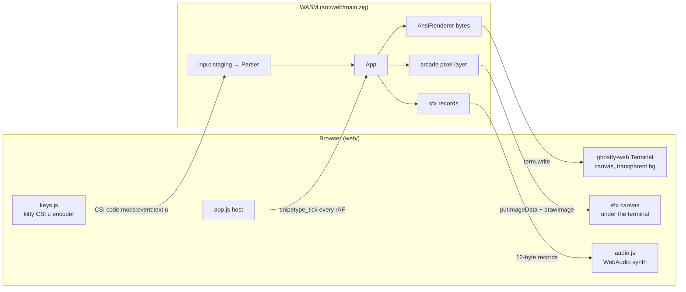
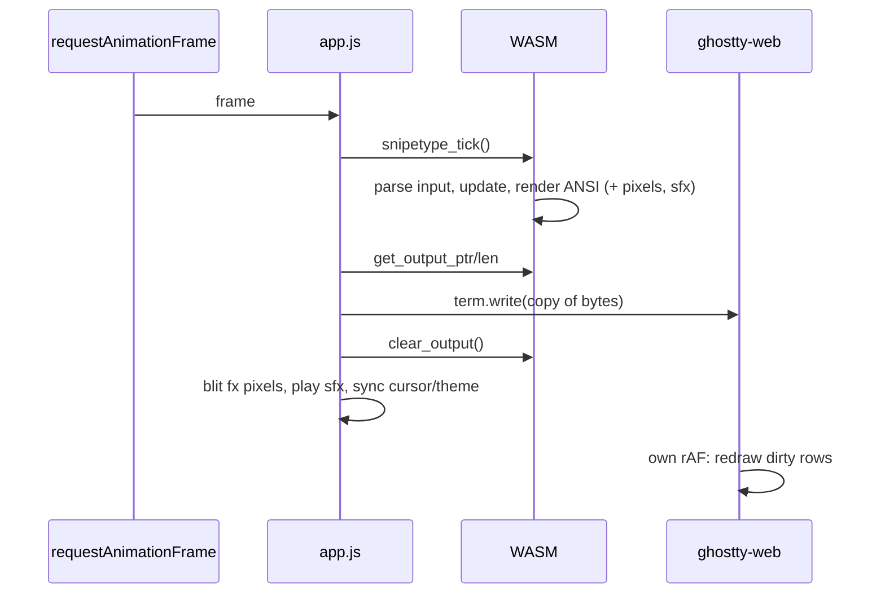

# Web Architecture

snipetype runs in browsers as WebAssembly. The Zig core renders **ANSI escape
sequences**, the same output the native terminal gets. A real terminal emulator draws
them in the page: [ghostty-web](https://github.com/coder/ghostty-web), which is
libghostty's VT parser compiled to wasm, plus a Canvas 2D renderer.

## Overview



## Files

```
web/
├── index.html         # Page: #screen (#fx + #terminal), footer controls, loading
├── style.css          # Full-viewport dark layout, theme CSS vars
├── app.js             # Host: wasm, ghostty-web terminal, frame loop, fx, theme, persistence
├── keys.js            # KeyboardEvent → kitty keyboard protocol (pure, tested)
├── host.js            # localStorage helpers, history cap, viewport font size (pure, tested)
├── audio.js           # Procedural WebAudio sound effects (+ record decoder)
├── keys.test.js       # bun test
├── host.test.js       # bun test
├── audio.test.js      # bun test
├── server.mjs         # Bun dev server
├── package.json       # dev / build:wasm / test / vendor scripts
├── vendor/ghostty-web/  # Vendored ghostty-web 0.4.0-next.21.g640db46 (MIT)
└── dist/
    └── snipetype_web.wasm
```

### Vendored ghostty-web

`vendor/ghostty-web/` holds `ghostty-web.js` (the ghostty VT wasm is inlined in it
as a base64 data URL), `__vite-browser-external-2447137e.js` (a 41-byte stub it
imports), `index.d.ts`, `LICENSE` and `VERSION`. No bundler is used: `app.js`
imports the file directly. To upgrade, bump the pinned `devDependencies` version
in `web/package.json`, run `bun run vendor`, and update `VERSION`. Check whether
the `__vite-browser-external-*.js` file name changed.

**Why ghostty-web, and why this build:** the old host drew a cell grid
exported by wasm onto a canvas itself. Now the web build renders the same ANSI
bytes as the native one, through a real terminal emulator. That means one
renderer, identical output in both, and true colors, synchronized frames and
cursor handling for free. We pin `0.4.0-next.21.g640db46` (the `next` channel)
because the stable 0.4.0 lacks fixes we rely on, such as mouse tracking. The
version is vendored, not loaded from a CDN, so the page works offline and is
reproducible. ghostty-web has these quirks, which the host works around:

| Quirk | Workaround |
|---|---|
| Theme changes after `open()` are ignored, and so is OSC 10/11 | The background is always transparent, and the page paints the theme bg. Cursor colors are set on `term.renderer.theme`. The System theme is the only one that relies on the terminal's default foreground, so when the OS color scheme flips, the host recreates the terminal. |
| DECSCUSR (cursor shape) is ignored | wasm exports `snipetype_get_cursor_style()`, and the host sets `term.options.cursorStyle`. |
| A cell bg of exactly `#000000` is never painted | Default-bg cells resolve to 0,0,0, which keeps them transparent. Use `#010101` for an opaque black. |
| Kitty keyboard flags requested by the app are ignored, and the legacy encoder can't tell chords apart | The host encodes keys itself (see Keyboard). |
| No kitty graphics | The arcade pixel layer goes on its own canvas. |
| Mode 2026 (synchronized output) is parsed but not used for rendering | Each tick writes one complete frame, so there is no tearing. |

## WASM Exports

### Lifecycle

| Function | Description |
|----------|-------------|
| `snipetype_init(cols, rows, seed) i32` | Initialize the app (0 ok, -2 app init failed) |
| `snipetype_deinit()` | Clean up |
| `snipetype_resize(cols, rows)` | New grid size; forces a full redraw |
| `snipetype_set_cell_px(w, h)` | Cell size in CSS px (from `term.renderer.getMetrics()`); stored in `cell_px_w/h` for the arcade surface size |
| `snipetype_reset()` | Restart test |

### Input

| Function | Description |
|----------|-------------|
| `snipetype_input_staging_ptr()` | Get input buffer pointer |
| `snipetype_input_staging_cap()` | Get buffer capacity (4096) |
| `snipetype_input_commit(len)` | Parse `len` committed bytes (kitty `CSI u`, pasted text) |

### Main loop and output

| Function | Description |
|----------|-------------|
| `snipetype_tick()` | Process input, update, render a frame if needed |
| `snipetype_get_output_ptr() usize` | ANSI bytes rendered since the last clear |
| `snipetype_get_output_len() u32` | Their length (0 = nothing to write) |
| `snipetype_clear_output()` | Drop them after copying |
| `snipetype_get_cursor_style() u32` | 0 hidden, 1 block (vim normal), 2 bar (typing), 3 underline (`App.cursorStyle()`, shared with the native cursor) |

Each rendered frame is wrapped as `ESC[?2026h … ESC[?2026l`. It ends by moving
the cursor to the typing position and showing it with `ESC[?25h`, or hiding it with
`ESC[?25l` in the settings overlay, on the results screen and in arcade mode.

### Arcade pixel layer

| Function | Description |
|----------|-------------|
| `snipetype_fx_active() u32` | 1 while arcade mode renders pixels |
| `snipetype_get_fx_ptr() usize` | RGBA8 pixels, row-major, `w*h*4` bytes |
| `snipetype_get_fx_width() u32` | Pixel width |
| `snipetype_get_fx_height() u32` | Pixel height |

Each frame, while this layer is active, the host does the following:
1. It `putImageData`s the buffer into an offscreen `w×h` canvas.
2. It `drawImage`s that canvas, scaled with high-quality smoothing, into `#fx`.

`#fx` is positioned exactly on the terminal canvas rect, at device-pixel resolution,
below it in z-order. The arcade text layer uses the default bg, so its cells are
transparent and the pixels show through. When the layer is inactive, `#fx` is
cleared and hidden.

While arcade is active the host adds the `arcade` class to `<html>`:
- The page background, the margin FitAddon leaves around the whole-cell grid
  and the footer all switch to the scene's night color, `#0b0c22`. Outside
  arcade the theme bg is restored.
- The footer's brand is hidden. Only a dimmed sound toggle remains (key
  hints live in the app's own footer row, not in the page).

### Sound effects

| Function | Description |
|----------|-------------|
| `snipetype_get_sfx_ptr() usize` | Queued records |
| `snipetype_get_sfx_len() u32` | Record count (queue holds 64) |
| `snipetype_clear_sfx()` | Drop them after playing |

Each record is 12 bytes, little-endian: `{ kind: u32, pan: f32 (-1..1), intensity: f32 (0..1) }`.

| kind | sound | kind | sound |
|---|---|---|---|
| 0 `key_letter` | clicky switch | 7 `milestone` | sparkle pings |
| 1 `key_digit` | tactile bump | 8 `fx_tier1` | tick/pop |
| 2 `key_big` | thock | 9 `fx_tier2` | crackle + zap |
| 3 `key_arrow` | linear, soft | 10 `fx_tier3` | whoosh + sub boom |
| 4 `wrong` | 180 Hz triangle thunk + noise | 11 `phrase_done` | C-E-G arpeggio |
| 5 `miss` | crack | 12 `game_over` | descending line |
| 6 `level_up` | bells 880 and 1318.5 Hz | 13 `start` | click + rising octave |

Zig code queues sounds with `queueSfx(kind, pan, intensity)` in `src/web/main.zig`.
`audio.js` synthesizes them procedurally (no samples):
- Every voice goes through a StereoPanner, then a master gain, then a DynamicsCompressor limiter.
- At most 10 voices start per frame.
- The AudioContext is created on the first pointer or key gesture.
- The footer button toggles mute, and the choice is saved in `localStorage` as `snipetype.sound`.
- `?sound=0` / `?sound=1` overrides the saved setting for one visit.

### Configuration and state

| Function | Description |
|----------|-------------|
| `snipetype_set_mode(mode)` | 0 words, 1 sentences, 2 code, 3 vim, 4 arcade, 5 zen, 6 custom, 7 daily (clamped to the modes the core has) |
| `snipetype_get_mode() u8` | Current mode id |
| `snipetype_set_game(game)` | Arcade game: 0 words (default), 1 keys. A running arcade returns to its title |
| `snipetype_get_game() u8` | Current arcade game id |
| `snipetype_set_word_count(n)` | Set word count |
| `snipetype_set_time_limit(sec)` | Set time limit |
| `snipetype_set_lang(lang)` | Set language: 0 mixed, 1 zig, 2 rust, 3 go, 4 ts, 5 python, 6 c, 7 bash, 8 lua, 9 sql, 10 java, 11 yaml |
| `snipetype_set_theme(theme)` | Set theme |
| `snipetype_get_state()` | 0 waiting, 1 typing, 2 finished |
| `snipetype_get_wpm()` / `snipetype_get_accuracy()` | Stats |
| `snipetype_get_theme()` | Theme ID (0 system … 6 solarized_dark, 7 serika_dark, 8 catppuccin_mocha, 9 tokyo_night, 10 rose_pine, 11 everforest, 12 gruvbox_light) |
| `snipetype_is_vim() u32` | 1 while keys go to a vim editor (vim mode, or code with vim keys): Ctrl+R / Ctrl+V are sent, the insert bar uses the theme's insert text color |
| `snipetype_set_smooth_caret(on)` | The host draws the caret itself in the simple modes (the emulator cursor is then hidden there) |
| `snipetype_caret_visible() u32`, `snipetype_get_caret_x/y() u32` | Where the smooth caret goes this frame (cell column/row) |

Imports (`env`): `js_now_ms` (`performance.now()`), `js_unix_ms` (`Date.now()`,
history timestamps), `js_random_u32`, `js_system_prefers_light`.

### Persistence, paste and host facts

| Function | Description |
|----------|-------------|
| `snipetype_alloc(n) usize` / `snipetype_free(ptr, n)` | Buffers in wasm memory for the host to fill |
| `snipetype_load_saved(cfg_ptr, cfg_len, hist_ptr, hist_len)` | Saved config JSON and history JSONL (either may be 0/0). Applies the settings and theme, fills the personal bests, picks the first drill without 3 stars, resets the test |
| `snipetype_apply_query(ptr, len)` | URL query string (`mode`, `words`, `time`, `lang`, `tier`, `punct`, `numbers`, `theme`, `vim`, `drill`, `keys=plain\|vim`, `pace=off\|pb\|<wpm>`, `stop=off\|letter\|word`, `nobs=0\|1`, `layout`, `focus=normal\|weak`, `syntax=0\|1`, `sounds=0\|1`): beats the saved settings; applying it saves nothing (a later settings change saves the whole current config) |
| `snipetype_take_record_ptr() usize` / `_len() u32` | A new history line (JSON, no newline) after a valid run, once; ptr 0 when none |
| `snipetype_take_config_ptr() usize` / `_len() u32` | The config JSON after the theme, mode or test options changed, once |
| `snipetype_note_paste()` | Clipboard text was pasted: nothing is typed and the run is not recorded |
| `snipetype_set_host(flags)` | Bit 0: macOS. Bit 1: the Ctrl+W hint was already shown |
| `snipetype_take_hint_shown() u32` | 1 once after the one-time Ctrl+W hint was shown |
| `snipetype_confirm_leave() u32` | 1 while leaving would lose a run (typing, or a drill changed and not solved) |
| `snipetype_load_custom_text(ptr, len)` | The saved custom text at startup (no toast, not reported back) |
| `snipetype_set_custom_text(ptr, len)` | The dialog's text: sanitized by the core; custom mode restarts with it ("custom text: N words") |
| `snipetype_take_custom_ptr() usize` / `_len() u32` | The custom text once after it changed (saved to `snipetype.custom.v1`) |
| `snipetype_take_custom_dialog() u32` | 1 once after the settings `text` row asked for the dialog |
| `snipetype_custom_text_len() u32` | Length of the current custom text |
| `snipetype_pb_lines_ptr() usize` / `_len() u32` | One `"pb":true` record per personal best (kept when the history is trimmed) |

`app.js` keeps these `localStorage` keys, every access wrapped in try/catch
(private windows and blocked storage just don't save):

| Key | Contents |
|---|---|
| `snipetype.config.v1` | Config JSON: `{"v":1,"theme":"one-dark","mode":"words","words":25,"time":0,"lang":"mixed","tier":"common","punct":false,"num":false,"vim":"drills","keys":"plain","pace":"pb","pace_wpm":80,"stop":"off","nobs":false,"layout":"qwerty","focus":"normal","syntax":true,"sounds":false}` |
| `snipetype.history.v1` | One JSON record per line (format in `src/core/history.zig`), newest 1,000 runs kept; when lines are dropped the core's PB lines (`snipetype_pb_lines_*`) are written first, so personal bests survive (`host.js` `appendHistory`) |
| `snipetype.custom.v1` | The custom-mode text |
| `snipetype.hint.ctrlw` | `"1"` once the Ctrl+W hint was shown |
| `snipetype.sound` | Sound on/off (audio.js) |

Startup order: `snipetype_init` → `snipetype_set_host` →
`snipetype_set_smooth_caret` → `snipetype_load_custom_text` →
`snipetype_load_saved` → `?game=` → `snipetype_apply_query(location.search)`.
Each frame after the tick the host drains `take_record` (appended to the
history), `take_config` (rewritten), `take_custom` (saved) and
`take_custom_dialog` (opens the dialog).

### Custom text dialog

In custom mode the footer shows an **edit text** button; the settings `text`
row opens the same dialog. It is a `<dialog>` with a textarea and use/cancel.
While it is open the window key listener stands aside, so every key (Ctrl+V
too) goes to the textarea; "use" hands the text to
`snipetype_set_custom_text`. A clipboard paste on the custom idle screen
(before typing starts) also becomes the custom text, like a bracketed paste
natively; everywhere else a paste is still dropped.

### Typing sounds

`ctrl+p` → options → sounds (or `?sounds=1`) makes the classic modes click:
the core queues `keySfx` records for every key it handles (plus `wrong` for a
wrong letter) into the same sfx queue the arcade uses, and the host plays
them every frame. They respect the footer sound toggle (`?sound=` is still
the arcade/page toggle). Off by default.

### Smooth caret

In the simple modes (words, sentences, plain code, zen, custom, daily) the
core hides the emulator's cursor and reports the caret cell
(`snipetype_get_caret_x/y`); the host moves a `#caret` element over the
canvas with an 80 ms CSS transform transition, in the theme's accent color.
Vim views and the arcade keep the emulator cursor. `?caret=0` or
`prefers-reduced-motion` turn it off (back to the emulator's bar).

### Diffing renderer

Classic frames go through `DiffRenderer` (`src/platform/diff_renderer.zig`)
into the AnsiRenderer: only cells that changed since the last frame are
written, so a keystroke is a few dozen bytes for ghostty-web to parse
instead of a full screen. Arcade frames bypass it; the first classic frame
after the arcade repaints everything.

Paste: ghostty-web delivers clipboard text through `onData`, the same path
as IME and mobile input. A capture-phase `paste` listener marks the time, and
`onData` within 250 ms of it calls `snipetype_note_paste()` instead of
forwarding the text (the arcade drops pasted text as before).

## Rendering pipeline



The output bytes are copied with `.slice()` before `term.write`, because wasm memory
can grow, which detaches existing views.

## Keyboard

A capture-phase `keydown`/`keyup` listener on `window` routes every key before
ghostty-web sees it. The routing comes from `keys.js` `classifyKey`:

- **send**: The key is encoded as a kitty `CSI code;mods:event;text u`. It is then `preventDefault`ed and staged into wasm. Details:
  - Codes are unshifted. Letters use the layout's letter, lowercased. Digits use their position. Symbols use the US layout's unshifted character.
  - Functional keys use kitty's Private Use Area values (`src/platform/keys.zig` `code.*`). Arrows are 57350..57353, Home/End 57356/57357, F1 is 57364. Enter is 13, Tab 9, Backspace 127, Esc 27.
  - Modifier keys send their own events: ShiftLeft 57441 … MetaRight 57450.
  - `mods` = 1 + (shift 1, alt 2, ctrl 4, super 8, caps lock 64).
  - The event type is 1 for press, 2 for repeat and 3 for release.
  - `text` is the typed codepoint. AltGr or macOS Option characters type as text.
  - If the window loses focus, held keys get release events.
- **paste**: Ctrl+V (not in vim mode), Ctrl+Shift+V, Cmd+V on macOS and Shift+Insert, outside the arcade. The browser pastes and ghostty-web hands the text to `onData`; the host drops it (see Persistence, paste and host facts). In the arcade, Ctrl+V is a game key.
- **browser**: These keys are not `preventDefault`ed:
  - Every Cmd chord on macOS, except Cmd+P, which opens settings like Ctrl+P, and Cmd+Backspace, which `macCompat` sends as Ctrl+U (delete to the line start).
  - F5, F11 and F12.
  - Ctrl+Shift+I/J/C, the Ctrl zoom keys, Ctrl+Tab and Ctrl+PageUp/PageDown, Ctrl+L.
  - Ctrl+R, outside the arcade and vim mode (in vim it is redo; F5 still reloads).
  - The browser always keeps Ctrl+W/T/N/Q.

### Ctrl+W on Windows and Linux

The browser closes the tab on Ctrl+W (and opens one on Ctrl+T/N) before the
page sees the key; `preventDefault` can't stop it. The mitigations:

1. Ctrl+Backspace and Alt+Backspace delete a word everywhere, in the typing
   modes and in vim insert mode (Option+Backspace on macOS, where Cmd chords
   are the browser's and Ctrl+W works).
2. A `beforeunload` confirmation while `snipetype_confirm_leave()` is 1.
3. A one-time toast on non-Mac the first time vim insert mode is entered:
   "ctrl+w belongs to the browser here: use ctrl+backspace"
   (`snipetype_set_host` / `snipetype_take_hint_shown`, remembered in
   `snipetype.hint.ctrlw`).
4. The footer hints in the app say `ctrl+backspace` on the web.

5. **Fullscreen** (footer button; no key binding, since every key belongs to
   the typer): on entering fullscreen the host calls
   `navigator.keyboard.lock(["KeyW", "KeyT", "KeyN", "Escape"])` when the
   browser has it (Chromium; `host.js` `lockFullscreenKeys`). While locked,
   Ctrl+W reaches the app and deletes a word, and the Ctrl+W hint is
   suppressed (`snipetype_set_host` bit 1). Escape is locked too, so a vim
   Esc (or the arcade pause) stays in fullscreen: hold Esc, or use the
   button, to leave. Leaving fullscreen unlocks; browsers without the API
   just go fullscreen (and a single Esc leaves it).

### Font size

The font scales with the viewport so the terminal is about 100 columns wide:
`floor(innerWidth / 60)` px, clamped to 14–22 px (`host.js` `fontSizeFor`),
recomputed on window resize (`term.options.fontSize`, then a refit).
- **ignore**: IME composition and dead keys go to ghostty-web, which emits the composed text through `onData`.

## Development

```bash
cd web
bun run build:wasm   # zig build web-dist (ReleaseSmall wasm → web/dist/)
bun run dev          # http://localhost:8080 (PORT env overrides; falls back to +1, +2)
bun test             # keys.js / host.js / audio.js unit tests
```

URL parameters: `?mode=words|sentences|code|vim|arcade|zen|custom|daily`,
`&game=words|keys` (arcade), `&words=N` (1–250), `&time=SEC`, `&lang=…`
(also bash, lua, sql, java, yaml), `&tier=easy|common|5k|full`, `&punct=1`,
`&numbers=1`, `&theme=one-dark` (or `one_dark`), `&vim=drills|type`,
`&drill=<id or lesson>`, `&keys=plain|vim` (code), `&pace=off|pb|<wpm>`,
`&stop=off|letter|word`, `&nobs=1`, `&layout=qwerty|dvorak|colemak|colemak-dh`,
`&focus=weak`, `&syntax=0`, `&sounds=1` (typing sounds), `&caret=0` (no
smooth caret), `&sound=0|1` (page sound toggle). They beat the saved settings for the
visit; they are not saved unless you then change a setting, which saves
the whole current config. `words=N` without `time` is a word-count test even
when a time limit is saved, and `drill=` without `mode` opens vim drills.

`window.oneApp` exposes these methods:
- Configuration: `setMode`, `setGame("words"|"keys")`, `setWordCount`, `setTimeLimit`, `setLang`, `setTheme`, `setSound(on)`.
- Control: `reset`, `destroy`.
- Stats: `getStats()` returns `{mode, game, state, wpm, accuracy}`. For a timed
  test, accuracy counts only the typed part, so it matches the results card.
- Sound check: `playSfx(kind, pan, intensity)`.
