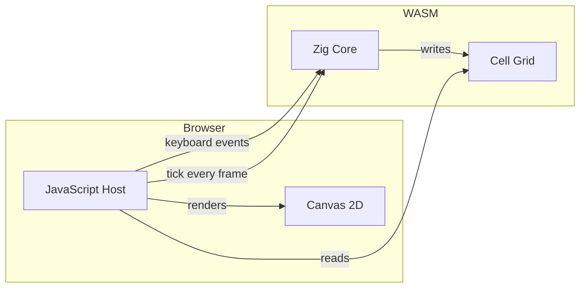
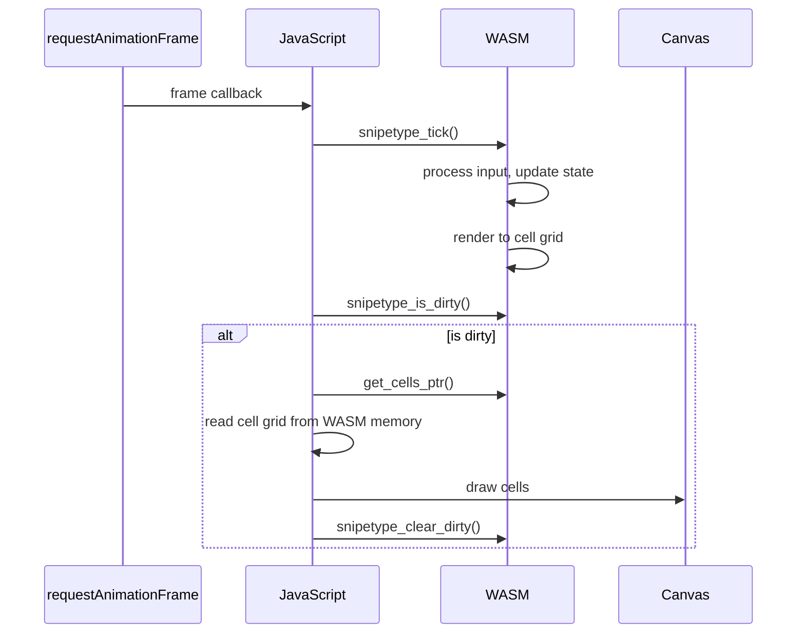

# Web Architecture

snipetype runs in browsers via WebAssembly with a JavaScript host.

## Overview



## Files

```
web/
├── index.html      # Page structure
├── style.css       # Minimal styles
├── app.js          # JavaScript host
├── server.mjs      # Dev server
├── package.json    # Dependencies
└── dist/
    └── snipetype_web.wasm
```

## WASM Exports

The Zig WASM module exports these functions:

### Lifecycle

| Function | Description |
|----------|-------------|
| `snipetype_init(cols, rows, seed)` | Initialize app |
| `snipetype_deinit()` | Clean up |
| `snipetype_resize(cols, rows)` | Handle resize |
| `snipetype_reset()` | Restart test |

### Input

| Function | Description |
|----------|-------------|
| `snipetype_input_staging_ptr()` | Get input buffer pointer |
| `snipetype_input_staging_cap()` | Get buffer capacity |
| `snipetype_input_commit(len)` | Commit input bytes |

### Main Loop

| Function | Description |
|----------|-------------|
| `snipetype_tick()` | Process frame |

### Cell Grid

| Function | Description |
|----------|-------------|
| `snipetype_get_cells_ptr()` | Get cell grid pointer |
| `snipetype_get_grid_width()` | Grid width in cells |
| `snipetype_get_grid_height()` | Grid height in cells |
| `snipetype_is_dirty()` | Check if redraw needed |
| `snipetype_clear_dirty()` | Clear dirty flag |

### Configuration

| Function | Description |
|----------|-------------|
| `snipetype_set_mode(mode)` | Set typing mode |
| `snipetype_set_word_count(n)` | Set word count |
| `snipetype_set_time_limit(sec)` | Set time limit |
| `snipetype_set_lang(lang)` | Set language |
| `snipetype_set_theme(theme)` | Set theme |

### State

| Function | Description |
|----------|-------------|
| `snipetype_get_state()` | Get test state |
| `snipetype_get_wpm()` | Get WPM |
| `snipetype_get_accuracy()` | Get accuracy |
| `snipetype_get_theme()` | Get theme ID |

## Cell Grid Format

Each cell is 8 bytes:

| Offset | Size | Field |
|--------|------|-------|
| 0 | 1 | Character (ASCII) |
| 1 | 1 | Flags (bold, etc) |
| 2 | 1 | FG Red |
| 3 | 1 | FG Green |
| 4 | 1 | FG Blue |
| 5 | 1 | BG Red |
| 6 | 1 | BG Green |
| 7 | 1 | BG Blue |

## Rendering Pipeline



## Input Handling

Keyboard input goes through a staging buffer:

```javascript
// 1. Get staging buffer pointer
const ptr = wasm.snipetype_input_staging_ptr();
const cap = wasm.snipetype_input_staging_cap();

// 2. Write key bytes to WASM memory
const view = new Uint8Array(wasmMemory.buffer, ptr, cap);
view.set(keyBytes);

// 3. Commit the bytes
wasm.snipetype_input_commit(keyBytes.length);
```

## Canvas Rendering

Uses Canvas 2D for crisp font rendering:

```javascript
ctx.font = `${FONT_SIZE}px "JetBrains Mono", monospace`;
ctx.textBaseline = "top";

for (let row = 0; row < rows; row++) {
    for (let col = 0; col < cols; col++) {
        const cell = getCell(col, row);
        
        // Draw background
        ctx.fillStyle = cell.bg;
        ctx.fillRect(col * cellWidth, row * cellHeight, cellWidth, cellHeight);
        
        // Draw character
        ctx.fillStyle = cell.fg;
        ctx.fillText(cell.char, col * cellWidth, row * cellHeight);
    }
}
```

## Development

```bash
cd web
bun run dev
# Opens http://localhost:3000 with hot reload
```

## Building for Production

```bash
# Build optimized WASM
zig build web -Doptimize=ReleaseSmall

# Copy to dist
cp zig-out/bin/snipetype_web.wasm web/dist/
```

WASM size: ~60KB (ReleaseSmall)
